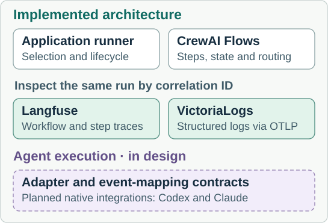
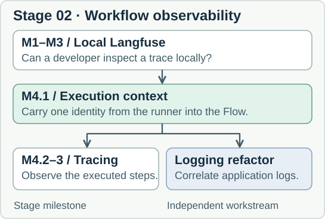

# Agent Playbook


Agent Playbook is a local-first Python project for building and observing workflows for agent orchestration. Its current runtime runs deterministic CrewAI Flows, traces their steps in Langfuse, and sends structured logs to VictoriaLogs. Agent execution through SDK adapters is the next architectural step.

The repository also preserves the engineering journey. You can follow a requirement into a design, see exactly what a coding agent was asked to implement, and read the review that sent working code back for correction.

[Explore the engineering journey](#the-engineering-journey) · [Run the application](#getting-started) · [Browse the design workspace](designs/README.md)

## The architecture

CrewAI owns step ordering, branching, and state. The application runner selects a configured workflow and invokes its shared contract for preparation, execution, validation, and output. Each workflow keeps its own business rules. A correlation ID connects the workflow’s trace and application logs across the two observability tools.



The checkout includes three integrated workflows, eight standalone orchestration recipes, and a CLI for local services, quality checks, and verified wheel builds. The agent execution foundation is in design. Its proposed adapters would translate supported SDK events into a shared representation. Native Codex and Claude integrations are planned for a later stage. [Architecture](designs/architecture.md) · [Current progress](designs/progress.md)

## Getting started

Clone the repository and enter the checkout:

```sh
git clone https://github.com/SharonLanger/agent-playbook.git
cd agent-playbook
```

Before bootstrap, [prepare the external settings file](app/docs/configuration.md#general-secrets-file). For a first run without Langfuse keys, use the [local configuration override](app/docs/configuration.md#langfuse-settings). From the repository root, bootstrap installs the pinned environment and runs the first workflow and local checks:

```sh
python3 app/tooling/bootstrap.py
```

[Application setup](app/README.md) · [Workflows and expected results](app/docs/workflows.md) · [CLI commands](app/docs/cli.md)

## The engineering journey

The project began with a question: what needs to work before a workflow makes its first real agent call? The charter sets the purpose. The architecture assigns responsibilities, and the roadmap turns them into stages with bounded outcomes. Within an agreed boundary, a design can develop locally. When a change affects a shared interface or moves responsibility between components, the owners revisit the affected contracts before implementation. [Charter](designs/charter.md) · [Engineering principles](designs/principles.md) · [Roadmap](designs/roadmap.md)

**A stage becomes concrete through its milestones.** Take Stage 02, workflow observability. First, a local Langfuse installation had to receive an inspectable trace. Then the runner, workflow wrapper, and Flow needed to carry the same execution identity. With that in place, a later milestone could ask a sharper question: does the trace show the branch that actually ran, including a controlled failure? An independent logging refactor reused the same identity to correlate records across systems. [Stage 02 milestones and evidence](designs/stages/02-langfuse/README.md) · [Logging closeout](designs/refactors/logging/progress.md)



The current method keeps one design PR open for a stage and opens a separate implementation PR for each milestone. Requirements capture the outcome and constraints. Research resolves open questions where needed. Decision records preserve the chosen approach and its trade-offs. Three documents then turn that work into a handoff:

| Part of the handoff | What the implementer receives |
| --- | --- |
| Design | Responsibilities, interfaces, dependencies, and expected failure behavior |
| Test cases | Observable evidence for each requirement, including rejection and failure paths |
| Implementation plan | Scope, dependencies, expected changes, and verification steps |

The maintainer approves those documents at a specific Git revision. That gives the coder and both reviewers the same answer to “what did we agree to build?” [Stage and milestone method](designs/governance/stage-milestone-workflow.md) · [Design contract](designs/governance/design-contract.md)

## From design to implementation

Codex coordinates a coder and two independent reviewers. The coder implements the approved package. The coordinator freezes a code-and-test commit so both reviewers examine exactly the same candidate.

The **design reviewer** traces the change back to its contract: did a component take on work it should never perform? The **test reviewer** follows each promised behavior to its assertion: could the test still pass if that behavior broke?


The coordinator records both verdicts. Required fixes go back to the coder, then both reviewers inspect the new commit. A candidate can pass on the first round. If required findings remain after the third, work pauses for an explicit decision. Passing reviews take the candidate back to the originating design session for final review. The maintainer evaluates the verification evidence, accepts the outcome, and separately authorizes the merge. [Codex handover and review rules](designs/governance/codex-handover-rules.md)

## Engineering in practice

### A tracing failure changed a successful result

During the logging refactor, a design reviewer supplied a workflow whose output was valid for the caller but could not be converted into a trace payload. The workflow produced its display result, then raised a serialization error **even with Langfuse disabled**. An argument to the tracing helper was being evaluated before the helper checked whether tracing was enabled.

The coder moved conversion inside the enabled tracing path and its error handler. In round two, the reviewer repeated the probe with tracing off and on. Both runs returned the valid display result. With tracing enabled, the conversion failure produced a warning. [Original finding](designs/refactors/logging/m2-application-logging/reviews/round-01/design-drift.md) · [Verified correction](designs/refactors/logging/m2-application-logging/reviews/round-02/design-drift.md)

### A green test allowed the work it was supposed to forbid

A workflow wrapper had to reject invalid input before constructing or starting a CrewAI Flow. The original test observed the expected exception and failed lifecycle state. A reviewer made the wrapper **construct and run the Flow first**, then raise the expected error. The test still passed.

The strengthened test observes both the constructor and `kickoff` and checks that neither was called. Temporarily restoring premature construction now failed the intended assertion: one constructor call where zero were allowed. [Test-review finding](designs/refactors/workflow-contract/review-test-quality.md#q1--prove-invalid-input-cannot-construct-or-start-a-flow) · [Negative-control evidence](designs/refactors/workflow-contract/review-test-quality.md#completion-evidence--pr-40)

To follow another decision from its original question through acceptance, open a stage or refactor in the [design workspace](designs/README.md).
