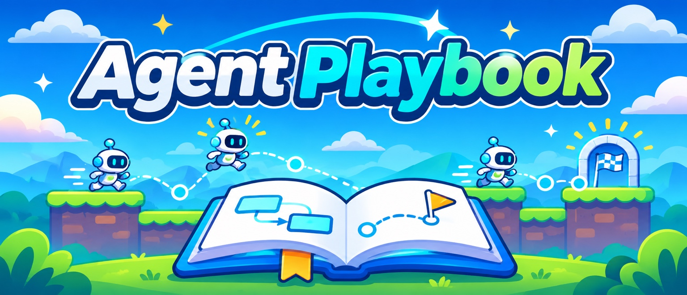
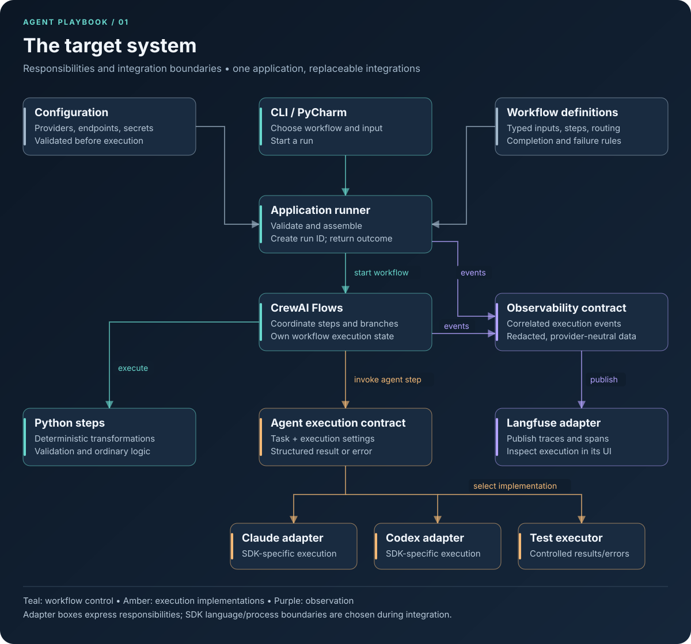

# Agent Playbook




Agent Playbook is a local-first Python environment for agent orchestration. Today it runs deterministic workflows with CrewAI Flows, captures their traces in Langfuse, and sends structured application logs to VictoriaLogs.

> Beyond the implementation, this repository preserves the reasoning behind Agent Playbook’s architecture. The design records show which alternatives were considered and what changed along the way. The learning guides carry those lessons forward, so you can explore not just what was built, but how and why.
>
> [Explore the engineering journey](#the-engineering-journey)

## The architecture

The diagram below shows the **full target architecture**, from the CLI and application runner through workflow execution, observability, and provider adapters.



**Working today.** The runner selects a configured workflow. CrewAI owns step ordering, state, and routing. A shared correlation ID connects Langfuse traces with application logs in VictoriaLogs. The checkout includes three integrated workflows and eight standalone orchestration recipes.

**In design.** The agent execution layer defines the intended boundary for SDK adapters. Native Codex and Claude integrations are planned.

- [Architecture and component responsibilities](designs/architecture.md)
- [Current implementation and acceptance](designs/progress.md)

## Getting started

Clone the repository and enter the checkout:

```sh
git clone https://github.com/SharonLanger/agent-playbook.git
cd agent-playbook
```

Before bootstrap, [prepare the external settings file](app/docs/configuration.md#general-secrets-file). For a first run without Langfuse keys, use the [local configuration override](app/docs/configuration.md#langfuse-settings). From the repository root, bootstrap installs the pinned environment and runs the first workflow and local checks:

```sh
python3 app/tooling/bootstrap.py
```

- [Application setup](app/README.md) — prerequisites, bootstrap, and PyCharm setup.
- [User documentation](app/docs/README.md) — the guide index for CLI commands, releases, configuration, tracing, logging, and troubleshooting.
- [Run a workflow](app/docs/workflows.md) — choose a workflow, supply input, and check the result.

## The engineering journey

The project began with a question: what needs to work before a workflow makes its first real agent call? The charter establishes the purpose, and the architecture defines what each component owns. The roadmap divides that work into stages. Each stage has a design PR where its boundaries, requirements, and decisions stay together.

**A milestone gives the stage one outcome a reviewer can verify.** In Stage 02, one milestone asked whether the runner, workflow wrapper, and CrewAI Flow all received the same execution identity. That gave the tracing work a stable way to follow a run, and the later logging refactor reused it. [Stage 02 milestone evidence](designs/stages/02-langfuse/README.md)

For each milestone, research settles open questions and the decision record captures the trade-offs. If a proposal changes a shared interface, the affected contracts come back for review. Once the scope is agreed, three documents turn the milestone into a Codex handoff.

| Part of the handoff | What the implementer receives |
| --- | --- |
| Design | Responsibilities, interfaces, dependencies, and expected failure behavior |
| Test cases | Observable evidence for each requirement, including rejection and failure paths |
| Implementation plan | Scope, dependencies, expected changes, and verification steps |

The maintainer approves those documents at a specific Git revision. That gives the coder and both reviewers the same answer to “what did we agree to build?”

- [Project charter](designs/charter.md) and [engineering principles](designs/principles.md) explain the project’s purpose and constraints.
- [Stage and milestone method](designs/governance/stage-milestone-workflow.md) describes the design PR and separate milestone implementation PRs.
- [Design contract](designs/governance/design-contract.md) defines how to review changes to an approved boundary.

## From design to implementation

Codex coordinates a coder and two independent reviewers. The coder implements the approved package. The coordinator freezes a code-and-test commit so both reviewers examine exactly the same candidate.

The **design reviewer** traces the change back to its contract: did a component take on work it should never perform? The **test reviewer** follows each promised behavior to its assertion: could the test still pass if that behavior broke?


The coordinator records both verdicts. Required fixes go back to the coder, then both reviewers inspect the new commit. A candidate can pass on the first round. If required findings remain after the third, work pauses for an explicit decision. Passing reviews take the candidate back to the originating design session for final review. If final review uncovers a contract change, the design returns to the maintainer to approve a revised baseline before affected work resumes. The round count carries forward. On acceptance, the maintainer separately authorizes the merge. [Codex handover and review rules](designs/governance/codex-handover-rules.md)

## Engineering in practice

### A tracing failure changed a successful result

During the logging refactor, a design reviewer supplied a workflow whose output was valid for the caller but could not be converted into a trace payload. The workflow produced its display result, then raised a serialization error **even with Langfuse disabled**. An argument to the tracing helper was being evaluated before the helper checked whether tracing was enabled.

The coder moved conversion inside the enabled tracing path and its error handler. In round two, the reviewer repeated the probe with tracing off and on. Both runs returned the valid display result. With tracing enabled, the conversion failure produced a warning. [Original finding](designs/refactors/logging/m2-application-logging/reviews/round-01/design-drift.md) · [Verified correction](designs/refactors/logging/m2-application-logging/reviews/round-02/design-drift.md)

### A green test allowed the work it was supposed to forbid

A workflow wrapper had to reject invalid input before constructing or starting a CrewAI Flow. The original test observed the expected exception and failed lifecycle state. A reviewer made the wrapper **construct and run the Flow first**, then raise the expected error. The test still passed.

The strengthened test observes both the constructor and `kickoff` and checks that neither was called. Temporarily restoring premature construction now failed the intended assertion: one constructor call where zero were allowed. [Test-review finding](designs/refactors/workflow-contract/review-test-quality.md#q1--prove-invalid-input-cannot-construct-or-start-a-flow) · [Negative-control evidence](designs/refactors/workflow-contract/review-test-quality.md#completion-evidence--pr-40)

To follow another decision from its original question through acceptance, open a stage or refactor in the [design workspace](designs/README.md).
