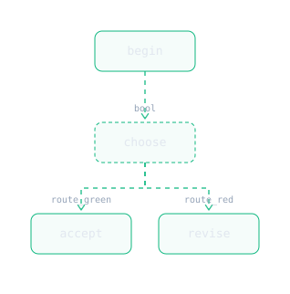

# 03 — Router labels select a branch

Open **run.py** and click Run in PyCharm, using `app/.venv/bin/python` as the interpreter.
No CLI registration, application runner, server, model key or other example is needed.
The working directory can be anywhere: inputs/settings are resolved next to run.py.

## Read and experiment

Compare this with example 02: choose has @router, so its returned string selects a label listener. begin returns a bool; choose receives it as its argument. Change approved to false in input.json to take the other route. Literal declares possible labels for typing/plot metadata; the actual returned string selects the path.

[Pause/resume viewer](diagram.html) · [Static diagram](diagram.svg)

Arrows show trigger dependencies, not elapsed time. Animation is illustrative, not a recorded trace.
All possible route edges are shown; a router selects one label per invocation.

## Files and starting point

1. `input.json`: edit the scenario's values.
2. `flow.py`: read the decorators, methods and state together.
3. `run.py`: loads settings and input, creates the flow and prints its result/state.
4. `settings.toml` and `settings.py`: example-local CrewAI setup before imports.
5. `test_ex_03.py`: verified outcomes, runnable as a pytest file in PyCharm.

`calls` is explicitly maintained by this example. It is not automatic framework history.
Framework banners, IDs and diagnostic output can differ; focus on the Result and State lines.
A failure propagates as an exception and nonzero exit, not a successful result string.

## Configuration

Integration settings are in settings.toml, separate from workflow input.json.
`CREWAI_DISABLE_TELEMETRY` and `CREWAI_TRACING_ENABLED` environment variables override
file defaults; only true/false (case-insensitive) are accepted. Start a fresh process after
changing these import-time settings. Enabling telemetry/tracing may cause network activity.
Tests force both off. There are no real agent/model calls in this example.
No secrets belong in these files. The project environment supplies pinned dependencies;
self-contained means example code/files, not a separate Python installation.

## Source and version

Written for the project's CrewAI **1.15.40** pin. See the main examples README for
source links and known documentation differences. Routing-pattern examples are original
teaching adaptations, not an unchanged copy of the upstream sample.
