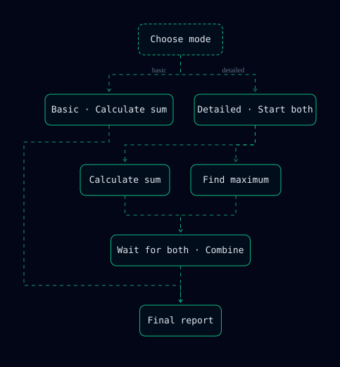

# 03 · Choose basic or detailed first



[Static fallback](diagram-static.svg) · [Local viewer with pause](diagram.html)

Choose how much analysis to perform before starting calculations. Keywords: router labels, conditional parallelism, chosen-path convergence.

## Run

Use the existing project interpreter (`app/.venv/bin/python`, Python 3.13, CrewAI 1.15.40). Open this folder's **run.py** in PyCharm and click Run, or invoke:

```bash
/absolute/path/to/app/.venv/bin/python /absolute/path/to/recipe_03_conditional_parallel/run.py
/absolute/path/to/app/.venv/bin/python /absolute/path/to/recipe_03_conditional_parallel/verify.py
```

Both entries resolve input/assets beside themselves and work from another working directory. Edit `input.json` for the small local scenario. `run.py` prints step markers, `STATE_JSON=...` and, on success, `RESULT_JSON=...`. Temporary `verify.py` checks defaults, variants, fresh-state isolation and direct/copied-folder entries. It remains for Sharon's hands-on review and will be deleted before merge.

## Wiring and default outcome

`choose_mode` routes to `route_basic` or `route_detailed`. `basic_sum` computes only sum. `start_detailed` triggers async `detailed_sum` and `detailed_max`, which meet at native `and_` in `combine`. Native `or_` converges the chosen completion into one `report`. Default detailed result is `{"mode":"detailed","sum":12,"max":6}`; basic returns the same keys with mode basic and max null. The basic path never waits for a detailed-only node.

## Try

1. Set `mode` to `basic`: no maximum branch or join runs.
2. Reverse the detailed branch delays; the report stays unchanged.

## Limits and copying

Copy this whole folder, including input and diagrams, and use an interpreter with the same installed pins. It imports only standard library, installed CrewAI/Pydantic, and its own `flow.py`. No application CLI/YAML, registry, agents, model keys or cloud services are needed. The entries set `CREWAI_DISABLE_TELEMETRY=true` and `CREWAI_TRACING_ENABLED=false` before importing CrewAI. These supported switches are not an OS network sandbox; CrewAI may create its normal local storage on import/construction. In restricted execution environments its installed LanceDB dependency may need socket permission even for initialization.

Typed local state validates the small demonstrated domain; delays are seconds in 0–1, loop bounds (where present) are 1–10. Async overlap demonstrates cooperative concurrency, not CPU parallelism or a performance guarantee. Ordered markers are teaching state, not durable event history. These recipes add no retries, recovery or production guarantees.

The diagram preserves the approved walkthrough's topology and example labels. Motion illustrates connectivity, not a measured trace; exclusive decision paths are alternatives. Loop-back annotations name backward transitions. Dashmotion 2.2.4 layout at ae2fe4f generated the local viewer, with script-free portable animated/static SVG exports. [MIT notice](DIAGRAM-LICENSE.txt) is retained. Python selection/counting rules are local policy; native CrewAI decorators own scheduling and joins.

## Official sources

- [CrewAI 1.15.40 Flow guide](https://github.com/crewAIInc/crewAI/blob/main/docs/v1.15.40/en/concepts/flows.mdx): typed state, listeners, async methods and routing.
- [Official routing patterns](https://github.com/crewAIInc/skills/blob/main/skills/build-flow/references/routing-patterns.md): joins, route labels and bounded loops; guidance may differ by version.
