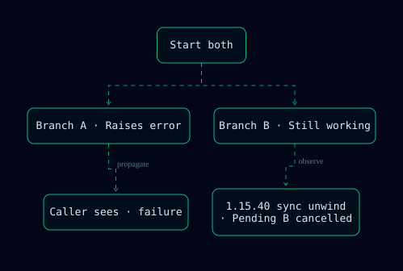

# 05 · Let one branch failure reach the caller



[Static fallback](diagram-static.svg) · [Local viewer with pause](diagram.html)

Inspect an unhandled exception in concurrent work. Keywords: propagation, failed caller, sibling lifecycle.

## Run

Use the existing project interpreter (`app/.venv/bin/python`, Python 3.13, CrewAI 1.15.40). Open this folder's **run.py** in PyCharm and click Run, or invoke:

```bash
/absolute/path/to/app/.venv/bin/python /absolute/path/to/recipe_05_parallel_failure/run.py
/absolute/path/to/app/.venv/bin/python /absolute/path/to/recipe_05_parallel_failure/verify.py
```

Both entries resolve input/assets beside themselves and work from another working directory. Edit `input.json` for the small local scenario. `run.py` prints step markers, `STATE_JSON=...` and, on success, `RESULT_JSON=...`. Temporary `verify.py` checks defaults, variants, fresh-state isolation and direct/copied-folder entries. It remains for Sharon's hands-on review and will be deleted before merge.

## Wiring and default outcome

`begin` starts async `branch_a` and `branch_b`. By default A raises `ValueError("recipe05: deliberate A failure")`. The exception propagates: the direct process exits 1, no `join` or `report` runs, and no successful result is printed. `run.py` prints final inspection state in `finally` and preserves the exception. With fail_a false, native `and_` calls `combine`, then `report` returns `{"A":"A complete","B":"B complete"}`.

Observed on CrewAI **1.15.40**, Python 3.13/Linux: with A failing before B finishes, both branches start and B records `B:cancelled` when the synchronous kickoff's event loop unwinds. With B's shorter delay, it records `B:done` before A fails. This describes these runs, not a general sibling-cancellation guarantee. The recipe only observes cancellation and re-raises it; it adds no cancellation or recovery policy.

## Try

1. Set `fail_a` to false for a successful combined result.
2. Set delay_a to 0.04 and delay_b to 0 so B finishes before A fails.
3. Compare B markers in both failure scenarios.

## Limits and copying

Copy this whole folder, including input and diagrams, and use an interpreter with the same installed pins. It imports only standard library, installed CrewAI/Pydantic, and its own `flow.py`. No application CLI/YAML, registry, agents, model keys or cloud services are needed. The entries set `CREWAI_DISABLE_TELEMETRY=true` and `CREWAI_TRACING_ENABLED=false` before importing CrewAI. These supported switches are not an OS network sandbox; CrewAI may create its normal local storage on import/construction. In restricted execution environments its installed LanceDB dependency may need socket permission even for initialization.

Typed local state validates the small demonstrated domain; delays are seconds in 0–1, loop bounds (where present) are 1–10. Async overlap demonstrates cooperative concurrency, not CPU parallelism or a performance guarantee. Ordered markers are teaching state, not durable event history. These recipes add no retries, recovery or production guarantees.

The diagram preserves the approved walkthrough's topology and example labels. Motion illustrates connectivity, not a measured trace; exclusive decision paths are alternatives. Loop-back annotations name backward transitions. Dashmotion 2.2.4 layout at ae2fe4f generated the local viewer, with script-free portable animated/static SVG exports. [MIT notice](DIAGRAM-LICENSE.txt) is retained. Python selection/counting rules are local policy; native CrewAI decorators own scheduling and joins.

## Official sources

- [CrewAI 1.15.40 Flow guide](https://github.com/crewAIInc/crewAI/blob/main/docs/v1.15.40/en/concepts/flows.mdx): typed state, listeners, async methods and routing.
- [Official routing patterns](https://github.com/crewAIInc/skills/blob/main/skills/build-flow/references/routing-patterns.md): joins, route labels and bounded loops; guidance may differ by version.
