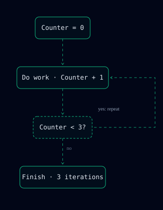

# 07 · Repeat a step a fixed number of times



[Static fallback](diagram-static.svg) · [Local viewer with pause](diagram.html)

Run a small unit of work through a native backward transition. Keywords: counter, router, fixed bound.

## Run

Use the existing project interpreter (`app/.venv/bin/python`, Python 3.13, CrewAI 1.15.40). Open this folder's **run.py** in PyCharm and click Run, or invoke:

```bash
/absolute/path/to/app/.venv/bin/python /absolute/path/to/recipe_07_fixed_loop/run.py
/absolute/path/to/app/.venv/bin/python /absolute/path/to/recipe_07_fixed_loop/verify.py
```

Both entries resolve input/assets beside themselves and work from another working directory. Edit `input.json` for the small local scenario. `run.py` prints step markers, `STATE_JSON=...` and, on success, `RESULT_JSON=...`. Temporary `verify.py` checks defaults, variants, fresh-state isolation and direct/copied-folder entries. It remains for Sharon's hands-on review and will be deleted before merge.

## Wiring and default outcome

`initialize` starts counter 0. Native `or_(initialize, "loop_again")` triggers `work`, which increments once and appends counter × 2. `check_bound` returns the distinct route label loop_again until the target, then loop_done triggers one `report`. Default is `{"count":3,"values":[2,4,6]}`. Each iteration is a separate Flow method execution, not a Python loop inside one node.

## Try

1. Set `iterations` to 1.
2. Set it to 10; both bounds terminate with one report.

## Limits and copying

Copy this whole folder, including input and diagrams, and use an interpreter with the same installed pins. It imports only standard library, installed CrewAI/Pydantic, and its own `flow.py`. No application CLI/YAML, registry, agents, model keys or cloud services are needed. The entries set `CREWAI_DISABLE_TELEMETRY=true` and `CREWAI_TRACING_ENABLED=false` before importing CrewAI. These supported switches are not an OS network sandbox; CrewAI may create its normal local storage on import/construction. In restricted execution environments its installed LanceDB dependency may need socket permission even for initialization.

Typed local state validates the small demonstrated domain; delays are seconds in 0–1, loop bounds (where present) are 1–10. Async overlap demonstrates cooperative concurrency, not CPU parallelism or a performance guarantee. Ordered markers are teaching state, not durable event history. These recipes add no retries, recovery or production guarantees.

The diagram preserves the approved walkthrough's topology and example labels. Motion illustrates connectivity, not a measured trace; exclusive decision paths are alternatives. Loop-back arrows show the labeled backward transitions. Dashmotion 2.2.4 layout at ae2fe4f generated the local viewer, with script-free portable animated/static SVG exports. [MIT notice](DIAGRAM-LICENSE.txt) is retained. Python selection/counting rules are local policy; native CrewAI decorators own scheduling and joins.

## Official sources

- [CrewAI 1.15.40 Flow guide](https://github.com/crewAIInc/crewAI/blob/main/docs/v1.15.40/en/concepts/flows.mdx): typed state, listeners, async methods and routing.
- [Official routing patterns](https://github.com/crewAIInc/skills/blob/main/skills/build-flow/references/routing-patterns.md): joins, route labels and bounded loops; guidance may differ by version.
