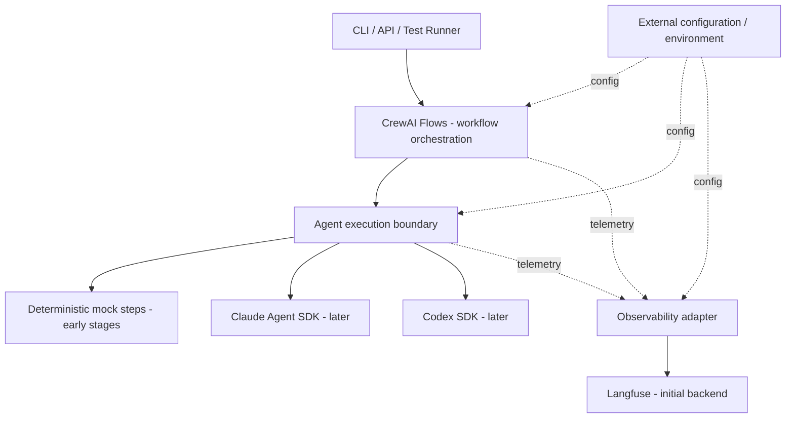

# Target Architecture — Proposed Protected Baseline

Status: **DRAFT / AWAITING EXPLICIT APPROVAL**

This is a direction-of-travel baseline, not a claim that the platform already exists.

## Responsibilities
- **Workflow orchestration**: CrewAI defines and executes graph/flow transitions and workflow state.
- **Agent execution**: initially deterministic functions; later agent SDKs behind replaceable adapters.
- **Observability**: instrument workflow and agent events through a narrow boundary; Langfuse is the initial backend, not a dependency scattered through workflow logic.
- **Configuration**: runtime environment selects endpoints, tokens, provider settings and behavior without source-code edits.
- **Testing**: deterministic regression checks for workflow state, routing, configuration and integration boundaries; real-service integration tests separately.

## Design limits
- No assumption that Langfuse is a live control-plane dashboard; evaluate operational monitoring later.
- Do not prematurely design stage-specific implementations or agent lifecycle semantics.
- A replaceable block may need a new adapter; only the public contract and callers should remain stable.
- Each active stage has its own approved end-state architecture consistent with this baseline.
