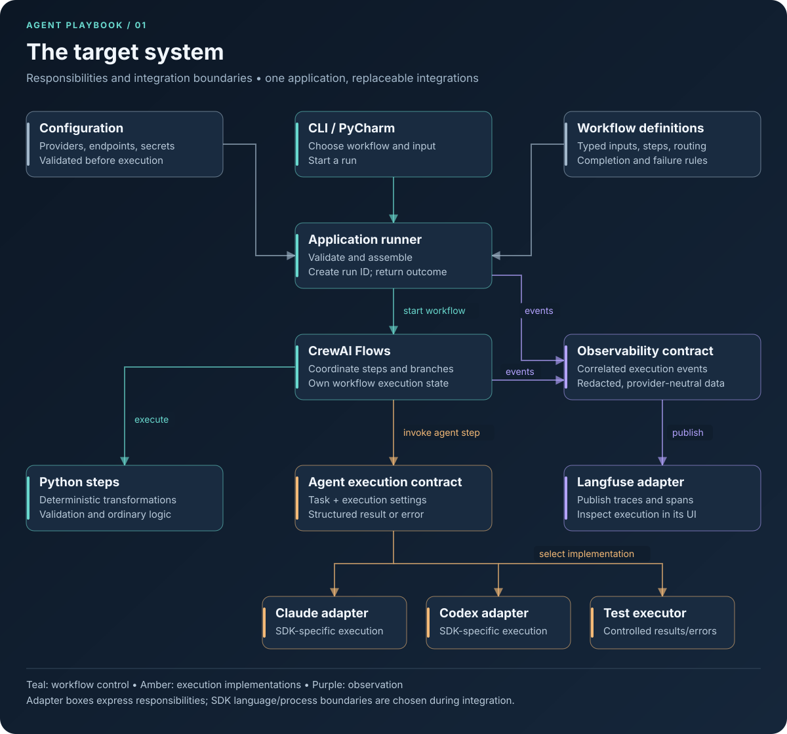
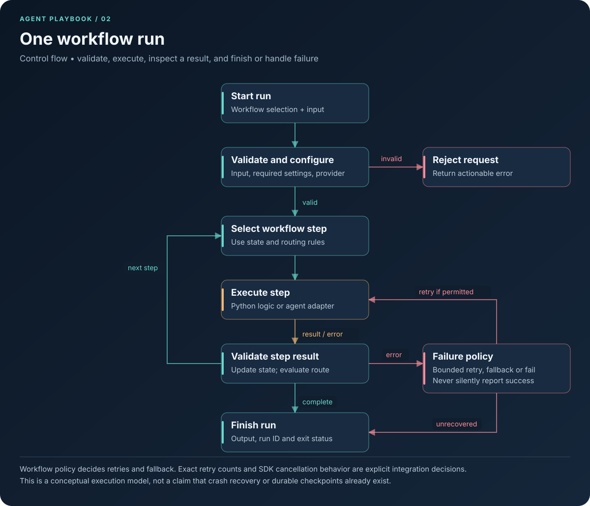
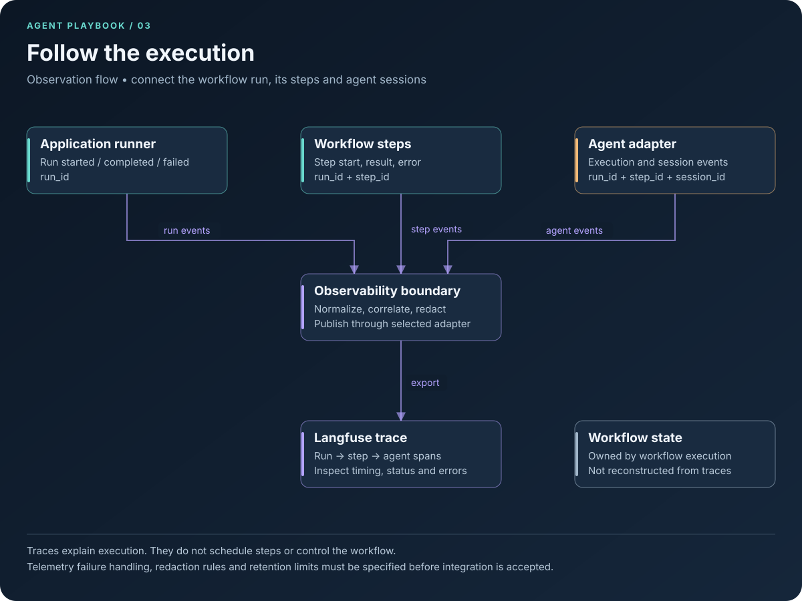

# Approved Target Architecture

Status: **GUARDED.** The approved component boundaries below remain in force. [Current implementation](progress.md) and [optional explorations](explorations/README.md) are separate records. [Open the permanent Atlas](atlas/README.md).

Revision: 2026-11-11 · Scope: the completed Agent Playbook application.

Agent Playbook is a reusable Python environment for defining, executing, observing
and testing workflows. A developer selects a workflow and supplies typed input.
The application prepares the run; CrewAI Flows coordinates its steps; Python logic
and agent SDK adapters perform the work; Langfuse exposes correlated execution traces.

[Open the diagram collection](diagrams/README.md) · [Walk through a run](learning/architecture-walkthrough.md)

## System structure

[Animated version](diagrams/01-system.animated.svg)

These are logical responsibilities. They do not imply separate network services.
The core is a local Python application. SDK adapters may use the runtime/process
boundary required by their SDK; this diagram does not assume both SDKs are native
Python libraries. Langfuse is accessed through its configurable integration.

| Component | Owns | Receives → produces |
|---|---|---|
| CLI / PyCharm entry point | User invocation and presentation | Workflow choice + input → output and exit status |
| Application runner | Validation, integration selection, run identity and overall outcome | Run request + configuration → workflow execution and run result |
| Workflow definition | Typed input/output, steps, branches and completion/failure rules | Input + step results → explicit routing decisions |
| CrewAI Flows | Execution of transitions and workflow state | Workflow definition + input → workflow outcome |
| Python step | Deterministic application logic | Typed step input → typed result or error |
| Agent execution contract | Provider-independent request/result semantics | Task + execution settings → result, failure and correlation metadata |
| Claude / Codex adapters | SDK-specific invocation and session handling | Generic request → SDK execution → normalized outcome |
| Deterministic executor | Controlled behavior for workflow regression tests | Fixture request → prescribed success or failure |
| Observability boundary | Event normalization, correlation and redaction | Execution events → provider-neutral observations |
| Langfuse adapter | Publishing observations to the selected backend | Observations + configured endpoint/credentials → traces/spans |

The runner prepares and starts a run. CrewAI executes the workflow's control flow.
A workflow can contain ordinary Python steps without invoking an agent.
Provider adapters become interchangeable only to the extent that they satisfy the
same contract; incompatible capabilities require an explicit contract decision.

## Execution and failure flow

[Animated version](diagrams/02-execution.animated.svg)

1. The entry point supplies the workflow selection and input to the runner.
2. The runner validates input and required configuration, selects integrations,
   creates a run identity, and starts observation of that run.
3. CrewAI executes the workflow's first eligible step and passes it the required data.
4. A Python step computes a result; an agent step calls the execution contract.
   Its adapter handles SDK-specific execution and maps the outcome back.
5. The workflow validates the result, updates its state, and selects the next step,
   branch, completion condition, or failure route.
6. The runner returns the final outcome and run identity. An unrecovered failure
   is reported explicitly and produces a nonzero CLI exit status.

Parallel branches are part of workflow definitions where needed. Their join rules
and failure semantics must be explicit in the relevant workflow's design.

| Condition | Required behavior |
|---|---|
| Invalid input or missing required configuration | Reject the run with an actionable error before starting work |
| Invalid step output | Treat as a step failure; do not feed malformed data into another step |
| SDK execution error or timeout | Adapter reports a classified failure; workflow applies its declared policy |
| Retryable failure | Retry only within an explicit bound, accounting for SDK retries and side effects |
| Unrecoverable failure | Record failure and return it; no successful completion claim |
| Observation export failure | Make the telemetry problem visible; specify whether execution continues or stops before integration acceptance |

This design does not promise exactly-once execution, automatic crash recovery or
safe retries of side effects. Those guarantees require concrete persistence,
idempotency and SDK behavior decisions before they can be claimed.

## State, sessions and observation

[Animated version](diagrams/03-observability.animated.svg)

| Information | Owner | Boundary |
|---|---|---|
| Run identity and overall outcome | Runner | Returned to caller and attached to execution events |
| Workflow state and step outputs | Workflow execution | Explicit inputs to subsequent steps |
| Agent session identity and SDK lifecycle | SDK adapter | Session references mapped to run/step identities |
| Traces, timing and diagnostic events | Observability integration | Inspection and diagnosis; not authoritative workflow state |
| Endpoints and provider selection | Configuration | Supplied at application assembly, outside workflow logic |
| Credentials | External secret configuration | Used by adapters; excluded from source control and telemetry |

A workflow run may involve multiple agent sessions. A session identifier alone is
not a workflow identifier. The event model connects a run, its steps and associated
agent executions without requiring workflow logic to import Langfuse-specific types.

Observation is not scheduling. Langfuse receives execution evidence; it does not
decide which workflow step runs next. Live workflow control, pausing and resuming
are not assumed capabilities of its UI.

## Configuration and replaceability

Configuration selects the workflow and integrations, supplies external endpoints,
and supplies credentials through environment-specific settings. The runner validates
required settings before execution. Secrets must not be copied into trace payloads.

Workflow code depends on narrow request/result contracts. SDK and Langfuse clients
remain inside their adapters. Changing a compatible implementation should change
assembly/configuration and the adapter, rather than every workflow step.

Exact request fields, SDK transport/language choices and provider capability checks
are specified when their integration is designed. A future REST API, queue service,
custom dashboard or additional orchestration framework is not required by this target.

## Verification and delivery

The same workflow definitions run against deterministic executors in regression tests.
Tests assert state transitions, routing, results and failure behavior. Live-provider
integration tests are explicit and separately configured.

The developer workflow is: one bootstrap → editable environment → named IDE/CLI tasks
→ local quality gate → versioned Wheel → hash verification → isolated installation.
Pyright, Ruff and pytest make up the local gate. The release records version, source
revision and SHA-256 evidence; a source-edit experiment verifies installation isolation.
Shared PyCharm task configurations are a completion requirement for Stage 00 (issue #24).

## Decisions to resolve at integration boundaries

The target fixes responsibilities and relationships. The relevant stage must settle:

- Whether workflow state needs durable checkpoints, and what resume guarantees mean.
- SDK cancellation, timeout, session reuse and capability differences.
- Retry budgets and idempotency rules for operations with side effects.
- Telemetry outage policy, redaction, payload limits and retention.

These open decisions must remain visible; they must not become implied guarantees
in diagrams or implementation. Proposed changes to agreed boundaries receive explicit
review. Implementation order is in [roadmap.md](roadmap.md); implemented behavior is
tracked in [progress.md](progress.md).

## Maintained views and exploratory boundaries

The Atlas is a visual projection, not another design authority. Its Current view identifies the implementation revision and labels approved-but-unimplemented capabilities. Explorations contains unfinished alternatives, including reviewer/coder/verifier roles and shared execution events; their detailed classes, schema and candidate folders are not approved implementation commitments.

The approved agent execution boundary remains provider-independent requests/results and explicitly compatible capabilities. Native SDK types stay inside adapters. The proposed refinement that maps native messages into execution events before projecting telemetry is preserved in the [agent execution exploration](explorations/agent-execution/README.md); its precise event/control schema remains under investigation.

Langfuse remains the approved initial tracing integration. Alternatives and application logging requirements are indexed in [observability exploration](explorations/observability.md). Traces and application logs have distinct purposes; their future storage/export choices are not decided by this Atlas update.

PR #34 proposes application assembly/factory/runner separation, release discovery/launcher separation and app-root YAML. It is pending at the recorded review revision; refer to project-structure.md for current-versus-pending paths. Do not treat an open PR as merged runtime behavior.

Apply the [mandatory design contract](governance/design-contract.md) before adding responsibilities or changing these boundaries. Preserve all approved historical stage baselines and their protection.
