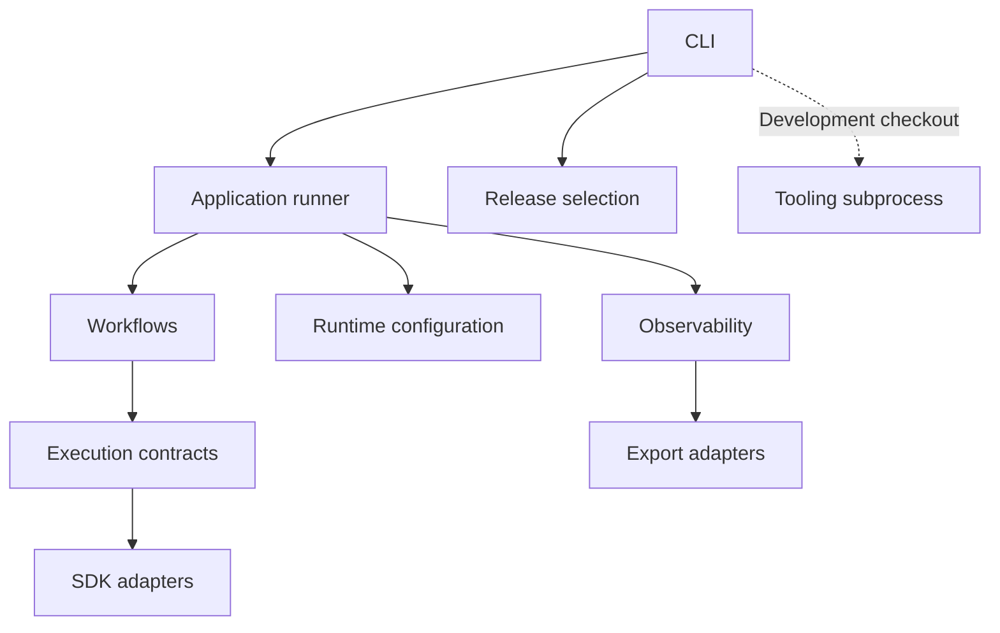

# Project structure

Status: **GUARDED.** Existing protection is retained; follow the design contract.

Status: **Approved structure / guarded baseline**. Approved by Sharon before the
pre-Stage 01 refactor. This file governs folder ownership; the target architecture
continues to govern behavior. Future component folders are reserved, not implemented.

## Change rules

Read this file before placing or moving code. Changes to the directory boundaries,
responsibilities, or dependency rules require explaining the logical additions/removals and consequences for each affected guarded file
and obtaining Sharon’s explicit approval before editing; keep an inspectable diff. Ordinary files added within an
existing boundary do not require a new structural approval. Never hide new behavior
inside a folder-only refactor. Keep imports, CLI entry points, PyCharm configurations,
checks, packaging, tests and documentation aligned when a path changes.

This is the current layout authority. The layout in the locked Stage 00 architecture
is historical; it does not override this explicitly approved refactor. Its historical
approval wording and CrewAI acceptance discrepancy are tracked in progress.md.

## Repository and application

| Path | Responsibility |
|---|---|
| `designs/` | Architecture, guarded structure, stage plans and learning records |
| `designs/diagrams/` | Diagram sources, static/animated SVG and viewer |
| `.run/` | Shared portable PyCharm tasks |
| `app/pyproject.toml`, `app/uv.lock` | Package metadata, dependency pins and check configuration |
| `app/configs/` | Shared external runtime YAML and ignored machine overrides; user guide in `app/docs/configuration.md` |
| `app/src/agent_playbook/` | Installed runtime Python package |
| `app/tooling/` | Bootstrap, quality checks, version changes, release build and verification |
| `app/examples/` | Sharon’s personal sandbox; no unrequested access/maintenance; excluded from the maintained application boundary |
| `app/examples/workflows/` | Personal sandbox contents; not catalogued, inspected or maintained by agents without a specific request |
| `app/tests/` | Maintained application/tooling tests with independent fixtures; no dependency on personal examples |
| `app/docs/` | Maintained official product documentation; update affected guides/indexes in the same PR; no internal/temporary material |
| `app/dist/` | Generated local releases; ignored by Git |
| `sandbox/` | Historical experiments; outside active application work |

`src` is a packaging boundary. Put application code inside `agent_playbook`,
then inside its owning component. Keep only package entry points and build metadata
at the package root. Tooling is also code, but it is developer code and is not shipped
in the application Wheel. Deployment/CI helpers belong under tooling when introduced;
this refactor creates neither deployment infrastructure nor CI.

## Runtime components

All paths below are relative to `app/src/agent_playbook/`.

| Folder | Ownership | Current contents |
|---|---|---|
| `cli/` | Parse arguments, display outcomes, delegate commands | Console/module entry points; checkout-tooling bridge |
| `application/` | Prepare and execute the selected application run | `runner.py` validates configuration/input and invokes a fresh selected workflow |
| `releases/` | Discover and launch completed local releases | `selection.py`; build logic stays in tooling |
| `config/` | Runtime settings and validation | YAML loader, validation, file selection and CrewAI startup mapping |
| `workflows/` | Named workflow packages with `flow.py`, `state.py`, `steps.py` | Stage 01 sequence, typed-state and conditional-route examples |
| `execution/` | Provider-independent agent execution contracts | Responsibility note |
| `execution/adapters/` | Separate SDK/provider implementations | Responsibility note |
| `observability/` | Provider-neutral events, correlation and redaction | Responsibility note |
| `observability/adapters/` | Exporters such as Langfuse | Responsibility note |

Create named workflows and provider subfolders as their stages introduce them.
Do not create speculative classes or empty implementations. Keep each workflow's
state and steps with that workflow rather than in global `models` or `utils` folders.

## Dependency rules

- CLI delegates execution to application and release selection; it owns no workflow logic.
- The application layer assembles workflows and integrations using runtime configuration.
- Workflows own routing/state and invoke execution contracts; provider clients stay in adapters.
- Observability events are provider-neutral; only exporters depend on backend clients.
- Runtime modules must not import checkout-only tooling or learning examples.
- The CLI's development bridge may invoke checks, version and release scripts in `app/tooling/` as subprocesses
  only in a development checkout. Installed releases reject all developer commands clearly.
- Tooling may invoke the application CLI. Building a release and selecting a release
  are separate responsibilities.

The graph expresses ownership and intended runtime flow; execution/observability
integrations remain future work. Stage 01 adds external integration configuration; future provider contracts remain deferred.

## Compatibility and validation

Preserve `agent-playbook` and `python -m agent_playbook.cli`, including `run`,
`run --version`, `dev-run`, `version`, `test`, and `check`. Preserve the direct
`python -m agent_playbook` entry point. Update shared Setup/Release paths to tooling.
Tests mirror runtime component folders and separately cover tooling. The maintained target excludes the personal examples sandbox; track implementation of exclusion separately from this ownership rule.
Validate the full local gate, clean bootstrap, wheel contents and isolated release
execution after structural moves. macOS PyCharm execution of changed paths requires local confirmation by Sharon.

## Permanent design ownership

| Path | Responsibility |
|---|---|
| `designs/AGENTS.md` | Mandatory design instructions, explicitly loaded from root instructions |
| `designs/governance/design-contract.md` | Guarded change/placement/maintenance contract |
| `designs/governance/guarded-files.md` | Minimum guarded-file register; existing protection is never silently removed |
| `designs/atlas/` | Permanent generated Current/Explorations viewer, catalog, builder, diagrams and viewing instructions |
| `designs/explorations/` | Indexed non-binding research, alternatives, POCs and unresolved discussions |
| `designs/refactors/` | Refactor-specific rationale, approval/review records and verification |
| `designs/stages/` | Permanent stage contracts, lessons and evidence; existing guards retained |

The Atlas is maintained from canonical Markdown and a navigation catalog. It does not authorize candidate folders. Reviewer/event-adapter/harness details are discoverable explorations, not additions to the approved runtime file tree.

## Current paths and pending PR #34

The Current view records main at `6f16508`. PR #34 head `59c6fff` remains open at this update. Preserve both states accurately until integration:

| Responsibility | Current main | Pending PR #34 |
|---|---|---|
| Runtime YAML | `app/configs/application.yaml` | `app/application.yaml` plus optional local sibling |
| Application execution | `application/runner.py` | `assembly.py`, `workflow_factory.py`, `workflow_runner.py` |
| Runtime release selection/launch | `releases/selection.py` | `releases/discovery.py`, `releases/launcher.py` |
| CLI argument parsing | Within existing CLI | Extracted `cli/parser.py` |
| Examples isolation | Legacy gate connections remain | Excluded from default tests/types/lint/format and release inputs; follow-up verification pending |

After #34 merges, reconcile this table, progress, the Atlas snapshot and public docs in one change. Do not retain old paths as current or restore old example-test ownership. Explicit user-invoked sandbox lint/format stays available outside automated gates. Move #34’s internal refactor-review guide to its owning designs/refactors directory when integrating it.
