# Agent Playbook — future architecture atlas

Prepared for Sharon · 13 November 2026 · **Design proposal, not an implementation or an approved baseline**

The recommendation is one modular Python application, with a small, owned execution contract between role code and provider runtimes. CrewAI owns workflow orchestration. A reviewer owns review instructions, evidence interpretation and review-result validation. A Claude or Codex adapter owns native invocation, message translation and supported controls. Langfuse receives an observability projection of what happened.

These are folders and in-process boundaries. They do not imply separate services, a message broker, a plugin framework, or a second agent loop above the native SDK. Add concrete modules when a stage needs them; this atlas shows their future homes in advance.

## 1. What this is based on

I read the repository's architecture, guarded project structure, charter, principles, roadmap, progress and diagram-authoring convention, plus the tree of the existing runtime-refactor PR. The sources are linked at the end.

| Snapshot | Verified status | How this guide uses it |
|---|---|---|
| Main, `6f16508d9f36da66edec04ddb055d8954f0f7c70` | Current approved structure | Behavioral and ownership baseline |
| Draft PR [#34](https://github.com/SharonLanger/agent-playbook/pull/34), head `30c8d96b16252d8c9d3238b2d9e29fea0bcc926e` | Open, unmerged at review time | Candidate foundation for the new file layout |
| This atlas | Exploratory future design | Adds roles, explicit execution events, adapter details and navigation levels |

Main currently has `app/configs/application.yaml`, `application/runner.py` and `releases/selection.py`. PR #34 proposes `app/application.yaml`, the application split and release discovery/launcher split. The inventory uses the PR snapshot for runtime context, excludes personal examples details and marks future additions separately. It is not a claim that those additions exist today.

The current roadmap is Stage 00 environment, Stage 01 deterministic CrewAI workflows, Stage 02 Langfuse, Stage 03 richer orchestration, Stage 04 isolated SDK experiments, Stage 05 integration, and Stage 06+ harness exploration. This future map does not reorder those stages or authorize implementation. This package is now proposed in a separate Atlas documentation PR; future runtime modules are not implemented.

## 2. How to zoom through the architecture

Use the accompanying **architecture-atlas.html**. Open its large blocks to move down a level; use the breadcrumb to move back. The Guide tab contains this explanation, and Files contains the complete expandable candidate tree with search.

| Level | Question answered | What is visible |
|---|---|---|
| Repository | Is this design, application code, development tooling, or an experiment? | `designs/`, `app/`, `sandbox/`, shared IDE tasks |
| Application directory | Does this ship, test, build, configure, or teach the application? | `src/`, `tests/`, `tooling/`, YAML, docs, examples, generated artifacts |
| Runtime package | Which component owns the behavior? | Application, workflows, agents, execution, observability, tools, CLI, config, releases |
| Component | Which responsibility inside that component changes? | Role definition versus handler; contracts versus adapters; semantic mapping versus telemetry |
| Concrete invocation | What calls what, and what data crosses the boundary? | Reviewer request, native stream, shared events, validated review, workflow routing |

Keep containment drawings, invocation drawings and dependency rules distinct. A box inside another box means ownership. An arrow in the runtime diagrams means data or control moving in the labeled direction. Import rules are described separately below. Animated motion is illustrative, not measured execution or proof that both provider branches run.

## 3. Repository and application blocks

| Block | Responsibility | Examples of things that belong here |
|---|---|---|
| `designs/` | Why the application is designed this way; stage learning and architecture decisions | This atlas, contract rationale, architecture diagrams, guarded decisions |
| `app/src/agent_playbook/` | Installed runtime package | Workflow, role, provider adapter, runtime release selection |
| `app/tests/` | Verify application and tooling behavior | Mapper fixtures, role-result tests, common adapter contract suite |
| `app/tooling/` | Develop, build and verify the application | Bootstrap, lint/type checks, wheel build, release verification |
| `app/application.yaml` | Shared external runtime configuration, as proposed in PR #34 | Selected workflow, provider selection, timeouts, observability settings |
| `app/application.local.yaml` | Optional ignored local overrides | Machine-specific nonportable settings; credentials remain out of tracked YAML |
| `app/docs/` | Maintained official product documentation | Public CLI, configuration, workflows and troubleshooting; internal/temporary documents belong in designs |
| `app/examples/` | Sharon’s personal sandbox | Excluded from agent access, maintenance and application tests unless explicitly requested |
| `app/dist/` | Generated release artifacts; ignored | Wheels and release metadata, not source modules |
| `.run/` | Shared PyCharm tasks | Setup, checks, tests, run and release |
| `sandbox/` | Historical experiments | Existing experimental material retained without migration |

Putting `application.yaml` directly under `app/` is appropriate for the current single application. Keep `config/` inside the runtime package: it contains the Python loader and typed settings, not another copy of the external YAML. Configuration location must remain explicit for installed releases; never depend implicitly on the caller's current directory.

### Why `releases/` stays inside `src`

`app/src/agent_playbook/releases/` contains runtime source that discovers and launches a selected built release. `app/tooling/release.py` builds one. `app/dist/` holds the generated artifacts. The similar names describe three different responsibilities; only the artifacts and tooling belong beside `src`.



[Static diagram](diagrams/05-release.svg) · [Pause/resume viewer](diagrams/05-release.html)

Discovery returns structured release information and selection failures. Launcher starts the selected release environment. CLI formats messages and exit codes. Neither discovery nor launcher should absorb build/version-bump logic or workflow routing.

## 4. Zoom into `app/src/agent_playbook/`



[Static diagram](diagrams/01-source.svg) · [Pause/resume viewer](diagrams/01-source.html)

| Folder | Owns | Does not decide |
|---|---|---|
| `cli/` | Arguments, command selection, presentation and exit codes | Review verdicts or workflow transitions |
| `application/` | Configuration validation, dependency assembly, workflow construction and run lifecycle | Native SDK message meanings |
| `config/` | Settings schemas, paths and loading | Workflow execution |
| `workflows/` | CrewAI flow/state, step order, routing and workflow retry budgets | Provider-specific stream parsing |
| `agents/` | Reusable role behavior: task input, instructions, tools needed, response validation and event reactions | Claude/Codex native object shapes |
| `execution/` | A provider-neutral invocation, lifecycle contract, capabilities, events and technical outcome | Whether a review approves the code |
| `execution/adapters/` | Implement that contract for native runtimes | Workflow policy |
| `tools/` | Reusable deterministic operations that can be exposed to an agent or called by Python | Agent reasoning loops |
| `observability/` | Correlation, telemetry projection, redaction, export policy | Workflow state or permission decisions |
| `releases/` | Runtime release discovery and launching | Building or publishing releases |

### Application files

| File | Purpose |
|---|---|
| `application/assembly.py` | Composition root. Construct the chosen executor, observer, roles and dependencies from validated settings. |
| `application/workflow_factory.py` | Build a fresh selected workflow with those dependencies. A small explicit registry is sufficient. |
| `application/workflow_runner.py` | Start a workflow run, establish correlation, apply run-level lifecycle handling and return an application outcome. |
| `application/results.py` | CLI-facing run outcomes. Keep role and provider results out of this module. |

Assembly is allowed to import concrete adapters. Roles and workflows receive typed interfaces. This is what makes replacement possible without requiring dynamic plugin discovery or a dependency-injection framework.

### Workflow expansion

Keep the existing `wf_01_step_sequence`, `wf_02_shared_state` and `wf_03_conditional_route` learning workflows. Introduce a separate illustrative `wf_code_review/` when real role integration is ready; its final identifier is a later stage decision.

| Candidate path under `workflows/wf_code_review/` | Responsibility |
|---|---|
| `flow.py` | CrewAI transitions: coder → reviewer → approved report or bounded revision |
| `state.py` | Typed workflow state: task, revision count, artifacts, review and final status |
| `inputs.py` | Public workflow input validation |
| `routing.py` | Explicit next-step decisions from validated role results |
| `steps/code.py`, `steps/review.py`, `steps/report.py` | Thin workflow-specific operations calling roles or deterministic code |
| `artifacts.py` | This workflow's artifact naming and references |
| `README.md` | Workflow behavior, failure paths and examples |

A small workflow can keep `steps.py`. Split it into `steps/` when separate operations justify it. Do not keep both. A helper used only by this workflow stays here with a descriptive name. A genuinely shared retry policy can later live in `workflows/policies/retry.py`; a generic `workflow_utils.py` tends to hide ownership. Shared role code belongs in `agents/`, even when several workflows use it.

## 5. Zoom into agents: a role includes real code

An agent role is more than a prompt, but its Python package is not itself the LLM. It prepares a task, requests an execution, interprets evidence and validates the resulting domain answer. The selected native runtime performs the model/tool loop.

| Candidate file under `agents/reviewer/` | Concrete behavior |
|---|---|
| `agent.py` | Accept `ReviewInput`, build an `ExecutionRequest`, consume events and produce `ReviewResult` |
| `models.py` | Typed review input, finding, severity, verdict and result |
| `context.py` | Prepare diff/context references and review scope |
| `instructions.md` | Stable role rules and review criteria |
| `prompts/system.md` | Prompt template/resource loaded by the role |
| `event_handler.py` | Consume our events, collect tool evidence, maintain review progress or publish typed role facts |
| `validation.py` | Validate findings, referenced files, required evidence and result consistency |
| `tools.py` | Reviewer-specific deterministic tool behavior, if needed; delegates reusable operations to `tools/` |
| `README.md` | Role contract, requirements and limits |

Coder and verifier use the same per-role organization. They need not have identical implementations or every file on day one. `agents/contracts.py` contains only shared role-facing concepts actually used by multiple roles; keep `ReviewResult` with reviewer.

For example, reviewer may record which files were examined; coder may record modified files and test attempts. Both can handle the same `ToolFinished` event differently. Neither needs `ClaudeMessage` or `CodexThreadEvent` imports. If the shared event does not contain required evidence, change the execution contract deliberately rather than reaching into a native payload.

Role-specific logging follows the same rule: the role emits meaningful facts such as a validated finding count; observability chooses trace representation and export. Raw diagnostic capture is adapter/observability policy, not arbitrary provider logging inside the role.

## 6. Zoom into execution and adapters



[Static diagram](diagrams/02-execution.svg) · [Pause/resume viewer](diagrams/02-execution.html)

| Candidate file under `execution/` | Purpose |
|---|---|
| `contracts.py` | Executor and live execution interfaces; optional controls expressed explicitly |
| `requests.py` | Instructions, context references, output requirements, limits, correlation and required capabilities |
| `events.py` | Typed canonical event union and common envelope |
| `results.py` | Technical execution outcome, final output, usage and failure information |
| `capabilities.py` | Supported features and preflight compatibility rules |
| `errors.py` | Stable failure categories such as unsupported capability, provider failure and invalid protocol |
| `service.py` | Preflight and invocation coordination; guarantees the contract around the selected adapter |
| `harness/README.md` | Reserved discussion boundary for shared execution policy; no harness framework designed here |
| `adapters/claude/` | All Claude-specific execution integration |
| `adapters/codex/` | All Codex-specific execution integration |
| `adapters/deterministic/` | Fixture-based executor for offline tests and learning |

The service is a small local coordinator, not another LLM loop. Start with a function if that is enough. A folder-level responsibility does not require a class per file.

Each provider folder has `executor.py`, `request_mapper.py`, `event_mapper.py`, `capabilities.py`, `controls.py`, `README.md` and its package marker. Codex may additionally need `transport.py` for the selected SDK/process protocol. Add `tool_bindings.py` only when custom tools enter that integration.

The **whole provider folder is the adapter**. `event_mapper.py` is one part of it. The adapter also handles native settings, startup/shutdown, session references, cancellation mapping and failure translation. This answers the earlier concern that an adapter would merely hide `async for message in query(...)`.

The exact Codex transport remains an SDK-stage choice. Its TypeScript SDK and its app-server protocol are different surfaces. A Python application can use an explicit process bridge or an app-server client; neither choice may leak transport objects into roles. Do not build both integrations in advance. The mapping example below labels the TypeScript SDK surface, while two research projects use app-server.

### Event translation is stateful when necessary



[Static diagram](diagrams/03-events.svg) · [Pause/resume viewer](diagrams/03-events.html)

An event mapper may consume several native messages to assemble one event, or emit multiple events from one native message. It tracks native message/tool identifiers, distinguishes snapshots from deltas and normalizes completion evidence. It is not necessarily a pure one-line rename function.

The adapter emits native-derived semantics; the execution coordinator adds application correlation and applies lifecycle validation. The live execution owns stream consumption. An async iterable is normally a single-consumer stream, not a broadcast bus: consume it once and dispatch to the role handler and telemetry projection explicitly. Do not have each subscriber iterate the provider stream independently.

### Proposed interface shape

This is design pseudocode using Python type annotations. The names below are ours, not existing SDK APIs, and are not implemented by this document.

```python
from collections.abc import AsyncIterator
from typing import Protocol

class ExecutionHandle(Protocol):
    def events(self) -> AsyncIterator[AgentEvent]: ...
    async def result(self) -> ExecutionResult: ...
    async def close(self) -> None: ...

class Executor(Protocol):
    async def capabilities(self) -> ExecutionCapabilities: ...
    async def start(self, request: ExecutionRequest) -> ExecutionHandle: ...

class EventHandler(Protocol):
    async def on_event(self, event: AgentEvent) -> None: ...
```

`start()` creates one invocation handle. In this candidate API the caller drains `events()` once before awaiting `result()`; `result()` returns the already accumulated terminal outcome. Premature stream closure is a failure, not a successful empty result. Always close the handle in `finally`. Reusable provider sessions are a separate optional concern; a workflow run is not a provider session.

Cancellation, permission decisions and steering require separate typed control contracts and capability checks. An observation callback returning `None` cannot veto a tool. For permission control, the adapter must expose the provider's actual pre-execution decision point, await a typed decision and map it back. A notification that a tool ran cannot retroactively stop it.

Python supports `ABC` plus `@abstractmethod` for required implementations and ordinary methods for overridable defaults. That matches the Java-style pattern discussed earlier. My recommendation here is a `Protocol` at component boundaries and an optional abstract base only when two implementations share real mechanics. Pyright checks static signatures; runtime boundary validation checks received data. Neither proves that two providers have equivalent capabilities.

## 7. Event schema, return values and honest differences

Avoid a universal event with dozens of optional fields. Use a discriminated union: each `type` selects a specific payload schema. Keep envelope fields common and domain results separate.

| Common envelope field | Meaning |
|---|---|
| `schema_version` | Version of our event contract |
| `event_id` | Unique identity within the recorded execution; assigned once and retained on replay |
| `run_id`, `step_id`, `execution_id` | Workflow, step and invocation correlation |
| `sequence` | Delivery order within this invocation, not a global clock |
| `observed_at` | When we observed it; preserve a separate native timestamp only when available |
| `source` | Adapter identity and native-versus-derived origin; no credentials |
| `type` + typed payload | Event-specific semantic data |

Provider session/thread identifiers are opaque scoped references, separate from those application IDs. Preserve useful native identifiers internally or in a restricted diagnostic reference. Canonical consumers must not depend on native payload extensions. An explicitly provider-specific experiment can use a separate opt-in API, but it then gives up provider portability for that feature.

| Proposed event | Payload / meaning |
|---|---|
| `execution.started` | Invocation accepted; selected adapter and supported profile |
| `text.delta` | Additional text for a particular message/content part |
| `text.snapshot` | Complete text observed so far; replaces the previous snapshot for that part |
| `tool.requested` | A request was observed; this alone does not prove the tool started |
| `tool.started` | Evidence of actual dispatch/start, only where supplied or directly controlled |
| `tool.finished` | Tool identity, outcome, output/artifact reference and optional typed execution evidence |
| `usage.updated` | Source-reported usage with explicit scope and cumulative-versus-incremental semantics |
| `execution.finished` | Exactly one local terminal outcome: completed, failed, cancelled or indeterminate |

This is a candidate vocabulary. Implement only events with actual consumers. Permission/input requests belong to a request/reply control interface when introduced; a corresponding observed event can be exported for traces, but it is not the response mechanism.

An `ExecutionResult` contains technical status, final text or structured JSON, usage if known, artifact references, opaque session reference where supported, and typed failure details. `completed` means the invocation completed successfully under the adapter contract. A completed review can still have the domain verdict `changes_required`. Output parsing/validation can also fail after the provider finished normally. Keep these outcomes distinct.

### Concrete normalization example

The native names below come from the currently retrieved Claude Python reference and Codex TypeScript source [S5–S7]. Mapping decisions in the last column are our proposal, not a guarantee made by either vendor.

| Evidence | Claude Python SDK | Codex TypeScript SDK | Our candidate mapping |
|---|---|---|---|
| Complete assistant text | `AssistantMessage` text blocks | `item.completed` with `agent_message` item | `text.snapshot`; preserve message identity |
| Partial text | `StreamEvent` with partial messages enabled | `item.updated` carries an updated item | Only true appended text becomes `text.delta`; otherwise use snapshots |
| Tool request/result | `ToolUseBlock`, `ToolResultBlock` | Item lifecycle with `command_execution` or `mcp_tool_call` | Distinguish requested/start/finished; preserve error evidence |
| Command exit code | No universal exit-code field in generic `ToolResultBlock` | `CommandExecutionItem.exit_code` is optional | Use a typed optional command-evidence field; absence remains unknown |
| Invocation result | `ResultMessage` plus error/stop fields; some calls can raise result errors | `turn.completed`, `turn.failed`, stream `error` | Classify terminal outcome; a closed stream alone is insufficient |

For Claude, do not test only `subtype == "success"`: current documentation describes error cases with that subtype. For Codex, an item's completion is not the turn's completion, and a command's nonzero exit code need not mean the whole invocation failed. These are reasons to keep mapping behavior tested inside adapters.

### Example canonical payload

Illustrative values; this is not a captured run. `null` explicitly means the information was not supplied. An MCP tool is not automatically a shell command.

```json
{
  "schema_version": 1,
  "event_id": "exec-42:7",
  "run_id": "run-12",
  "step_id": "review-1",
  "execution_id": "exec-42",
  "sequence": 7,
  "observed_at": "2026-11-13T10:00:00Z",
  "source": {"adapter": "codex", "origin": "native"},
  "type": "tool.finished",
  "payload": {
    "tool_call_id": "tool-3",
    "tool_name": "command",
    "outcome": "succeeded",
    "output_ref": "artifact:test-output-3",
    "evidence": {"kind": "command", "exit_code": 0},
    "duration_ms": null
  }
}
```

In implementation, define a model per payload and a typed evidence union; do not let nested unvalidated dictionaries become the effective interface. Runtime validation is especially necessary at JSON/process boundaries. Python dataclasses alone do not validate arbitrary incoming values. Decide a JSON-schema/Pydantic boundary during the relevant stage and keep Pyright strict throughout.

### Contract invariants

- Never infer missing success, zero cost, zero tokens or tool approval from an absent value. Use unavailable/unknown explicitly.
- Do not append a full snapshot as though it were a delta. Identify message/content parts and replace snapshots.
- A live invocation has one locally synthesized or native-derived terminal outcome. A disconnect can produce `indeterminate` with `may_have_side_effects=true`; it does not justify automatically replaying the task.
- Sequence numbers describe local observation order. They do not promise total ordering across nested agents or processes.
- Replay preserves assigned identity and observed timestamps. Offline normalization must not generate different IDs every time the same captured input is parsed.
- Usage snapshots must not be repeatedly added. Preserve provider accounting scope and distinguish unavailable costs from zero cost.
- Unknown additive native events may become redacted diagnostics. Invalid required payloads or a missing required terminal signal must fail explicitly.
- Do not promise exactly-once external side effects, cross-provider resume, durable recovery or interruption before checking the selected provider and transport.

## 8. Walk through a reviewer run

1. CLI requests the code-review workflow. The application loads validated settings and assembles a reviewer with a selected execution interface and telemetry sink.
2. CrewAI reaches the review step and calls `ReviewerAgent.review(ReviewInput)` with the diff and required context references.
3. Reviewer constructs instructions, output requirements and required capabilities. It creates a fresh per-invocation event handler; state is not shared accidentally between concurrent reviews.
4. Execution checks those requirements against the selected adapter. Unsupported required evidence/control fails before expensive work where it can be known in advance.
5. The provider executor starts the native runtime and reads native messages. Its event mapper translates them; execution applies the envelope and validates lifecycle order.
6. One dispatch loop delivers canonical events to the reviewer handler and an observability projection. Reviewer collects domain evidence. Telemetry records correlated, redacted progress.
7. After the terminal event, reviewer retrieves the technical result and validates structured review output against `ReviewResult`. A provider success with malformed review output becomes a role-validation failure.
8. The workflow receives a validated review: approve and report, request a bounded coding revision, or take an explicit failure/inconclusive path. Reviewer never silently schedules the next workflow step.

```python
# Illustrative role orchestration; names belong to our proposed code.
handler = ReviewEventHandler(review_input)
handle = await execution.start(build_review_request(review_input))
try:
    async for event in handle.events():
        await handler.on_event(event)
        await telemetry.observe_execution(event)
    result = await handle.result()
finally:
    await handle.close()

return validate_review_result(result, handler.evidence)
```

This is deliberately a single consumption path. The eventual dispatcher must define failures and backpressure: a role-handler failure fails the role and triggers cleanup; the recommended default for ordinary telemetry export is bounded buffering with an explicit warning/outage policy. If an audit requirement makes delivery mandatory, that becomes a distinct configured failure policy. This pseudocode does not implement those policies or guarantee cancellation support.

## 9. Add a verifier: which blocks change?

The important pushback is that a new role does **not** automatically justify a new provider interface. First classify its requirement.

| Verifier needs… | First place to change | Adapter change? |
|---|---|---|
| A result with passed checks, failed checks and an explanation | `agents/verifier/models.py`, instructions and validation | Usually no; use the existing output contract |
| To react differently to an existing tool event | `agents/verifier/event_handler.py` | No |
| A command exit code already available but discarded | Typed command evidence in `execution/events.py`; mapping and contract tests | Yes, update providers that expose that evidence |
| Evidence a provider does not expose | Capability requirements and explicit unavailable result | It cannot invent the evidence; reject a required capability or use another reliable source |
| To run pytest and trust the exit status | Deterministic verification tool or workflow step | Often no SDK schema change: capture process outcome directly |
| To stop a tool before it executes | Typed control contract plus permission capability | Yes, supported native pre-execution hooks/requests must implement it |
| A follow-up verification step after review | Workflow flow/state/routing | No role-specific provider adapter |

For the command-evidence case, model `CommandEvidence(exit_code: int | None, ...)` as one variant, not a mandatory `exit_code` on every tool. A verifier requiring authoritative exit codes declares that requirement. An adapter profile may provide it for commands while lacking it for arbitrary tools. Capability support describes scope and conditions, not just a brand-level boolean.

Prefer an application-owned verification operation when it gives stronger evidence. A subprocess return code captured by our deterministic test runner is more direct than asking an LLM to report whether tests passed. That tool belongs in runtime `tools/verification/`; its agent integration bindings belong in the relevant adapter. Developer `tooling/checks.py` still serves repository maintenance. Avoid making installed runtime code import checkout-only tooling.

## 10. Observability and the deferred harness boundary



[Static diagram](diagrams/04-observability.svg) · [Pause/resume viewer](diagrams/04-observability.html)

The approved design currently describes provider-neutral event normalization under observability in broad terms. This atlas proposes a sharper ownership split: **native runtime semantics → execution events** belongs in execution adapters; **execution/workflow/role facts → telemetry spans and logs** belongs in observability. Updating the guarded document to say this would be a future reviewable change.

Candidate observability files are `contracts.py`, `events.py`, `correlation.py`, `projection.py`, `redaction.py`, and `adapters/langfuse/exporter.py` plus `adapters/noop.py`. Its `events.py` defines telemetry records, not a competing copy of `AgentEvent`. The Langfuse exporter imports the Langfuse client; roles and workflows do not.

The harness boundary is intentionally provisional. Native Claude/Codex runtimes already own agent loops, tool behavior and native session mechanics. Future shared execution policy—tool availability, permissions, limits, context policy and hooks—may live under `execution/harness/` if it is cohesive. Role intent stays in `agents/`; reusable tool implementations stay in `tools/`; provider-specific bindings stay in adapters. We will decide the harness's actual interfaces and files separately. This guide does not create an extra loop, a universal permission model or a new harness framework.

## 11. Research: concrete Claude + Codex normalization examples

These are examples and design references, not a dependency adoption decision. I reviewed the linked primary documentation/source; I did not install these projects or validate their live provider behavior. Findings are current to the retrieval date above. Use pinned versions and a capability/contract trial before adoption.

| Reference | What it demonstrates | What to borrow / limitation |
|---|---|---|
| [Vercel AI SDK HarnessAgent](https://vercel.com/changelog/program-agent-harnesses-with-ai-sdk) and [overview](https://github.com/vercel/ai/blob/main/content/docs/03-ai-sdk-harnesses/01-overview.mdx) | A common API for Claude Code, Codex and other harnesses; projects output into shared streams/results | Useful larger-framework reference. TypeScript, explicitly experimental, and broader than our event layer. Some runtime-specific activity is represented through generic tool parts. |
| [Triad Labs harness-sdk adapter design](https://github.com/Triad-Labs-Inc/harness-sdk/blob/main/docs/provider-adapters.md) | Claude Agent SDK and Codex app-server behind capabilities, sessions, turn events and controls | Closest written adapter-contract example: shared tests and explicit unsupported features. It is a project design/implementation reference, not an industry standard or evidence of production maturity. |
| [UnifedAgentWrapper](https://github.com/PentestGPT-Project/UnifedAgentWrapper) | Python wrapper with common task input, normalized AgentEvent stream and UnifiedResult; Claude query and Codex app-server | Closest language-level example. Its README's permission/sandbox mapping must not be read as proof that those mechanisms provide equivalent isolation. |
| [GitHub Unified Agent Session Specification](https://github.github.com/gh-aw/specs/unified-agent-session-specification/) | Canonical session records and mappings for engines including Claude and Codex | Strong reference for trace schema, incomplete evidence, ordering and accounting. It is a session/trace normalization specification, not a drop-in live cancellation or approval interface. |

My recommendation is to study Triad's contract separation alongside GitHub's data-preservation rules, and use Vercel/Python wrappers as implementation comparisons. Keep our boundary small until we know which events and controls the first real reviewer needs. There is evidence that this pattern is used; there is not evidence here that one universal schema preserves all native behavior without trade-offs.

If an external normalizer later satisfies our needs, put its integration behind the same owned `Executor` contract and run the same contract tests. Avoid passing its enums and result objects throughout `agents/` and `workflows/`. Replacement then concentrates in assembly and the integration adapter. It can still require work if provider session persistence, tool semantics or control features are incompatible; an interface alone cannot erase those differences.

## 12. Complete file structure and ownership

The **Files** tab in the atlas is the complete expandable hierarchy. [full-file-structure.md](full-file-structure.md) contains every path and its status. The personal examples sandbox is shown only as an excluded boundary; its files are intentionally not catalogued. Existing examples tests are not part of the proposed maintained application structure. Proposed filenames are concrete examples of future ownership, not a request to create empty files now.

| Group | Future shape |
|---|---|
| Design navigation | `designs/refactors/atlas/README.md`, `architecture-guide.md`, `full-file-structure.md`, `architecture-atlas.html`, `diagrams/` |
| Role packages | `agents/coder/`, `agents/reviewer/`, `agents/verifier/` with code, typed models, instructions, prompts and handlers |
| Execution | Shared contracts, requests, events, results, capabilities, service; provider adapter packages |
| Workflows | Existing three workflows plus a future code-review workflow with its own state, routing and steps |
| Runtime tools | Typed tool definitions, repository operations and deterministic verification operations |
| Observability | Projection/redaction plus Langfuse/no-op exporters |
| Tests | Mirror each owner; shared contract tests across providers; recorded native fixtures; opt-in live integration tests |

Generated local overrides and `dist/` examples are marked generated/illustrative. The atlas's sample wheel name is not a promised future release version. The suggested design destination is also a proposal; this package is proposed under `designs/refactors/atlas/`.

### Dependency rules that make the folders meaningful

1. `application/assembly.py` wires concrete implementations. Configuration chooses from explicit supported options.
2. Workflows call roles and deterministic operations; roles depend on execution contracts and shared tool interfaces. A low-level SDK lesson can call execution directly without inventing a role.
3. Execution contracts/events/results import neither roles nor concrete provider packages. Adapters implement those contracts and may import their SDKs.
4. Provider types stay within adapters. A reviewer-specific native branch is a signal that either the shared contract is incomplete or that the feature is intentionally provider-specific.
5. Observability consumes execution/workflow/role facts. Execution contracts never depend on Langfuse. A role handler and a telemetry exporter have different responsibilities.
6. Runtime code does not import development tooling or learning examples. The existing CLI development bridge remains an explicit subprocess exception in a checkout.
7. CrewAI stays in workflow integration. Putting every `flow.py` behind a second orchestration framework is unnecessary for this project.

## 13. What to refactor now, and what waits

| Timing | Recommendation |
|---|---|
| Existing PR review | Review PR #34's application split, discovery/launcher split, CLI parser separation and YAML relocation as one behavior-preserving refactor. Keep its temporary verification helper while reviewing; decide removal explicitly later. |
| Documentation now | Review this future map separately. Once accepted, update the guarded ownership explanation with an exact diff and links to the zoom levels. |
| Observability stage | Implement workflow/run telemetry first, with execution-event projection added when real executions exist. |
| SDK experiment stage | Capture native fixtures, choose transport, document capability gaps and test a minimal mapping per provider. |
| Role integration stage | Add a real reviewer and only the event/result fields it consumes; add coder/verifier as their workflows require. |
| Harness discussion later | Decide shared policy/control boundaries using concrete requirements and provider evidence. |

Verification for the eventual implementation should include: strict typing and formatting; existing CLI/config/workflow tests; wheel contents and isolated execution; common adapter contract tests; mapper fixtures for success/failure/partial data; role tests using canonical fixtures; and opt-in live smoke tests. No LLM credentials are required for deterministic checks. No new CI system is implied.

Meaningful contract scenarios include missing terminal results, duplicate snapshots, unknown native events, malformed tool payloads, unsupported required capabilities, provider crashes after possible side effects, handler failures, telemetry outages, and cleanup. Test behavior, not whether every proposed class exists. Account for native SDK retries before adding workflow retry budgets.

### Open decisions

- Exact initial event vocabulary and runtime schema library.
- Codex SDK versus app-server transport and the capability profile of the chosen version.
- Permission/control interface, cancellation guarantees and shared harness ownership.
- Session reuse scope, persistence and durable recovery semantics.
- Event retention, redaction, payload limits and telemetry outage policy.
- When shared workflow policies have enough genuine reuse to extract.

### Alignment with project principles

| Principle | How this proposal treats it |
|---|---|
| Explicit approvals | Exploratory document; no guarded baseline or code changes |
| Security | Keeps credentials and raw payload policy at integration boundaries |
| No architectural drift | Calls out the event-ownership refinement for review |
| Learning | Protects personal examples and retains stage sequence |
| Isolated integrations | Provider and telemetry clients remain in adapters |
| External configuration | YAML plus typed loading; no hidden machine defaults |
| Quality gates | Defines behavioral checks appropriate to future changes |
| Evidence | Separates verified source behavior, third-party claims and proposals |
| Incremental delivery | Future files are a map, not a scaffold to generate now |
| Local first | One modular application with offline fixtures |
| No silent migration | Existing PR remains unmerged; path changes need explicit review |

## 14. Source links and verification scope

Repository sources at the reviewed main commit:

- [Architecture](https://github.com/SharonLanger/agent-playbook/blob/6f16508d9f36da66edec04ddb055d8954f0f7c70/designs/architecture.md)
- [Guarded project structure](https://github.com/SharonLanger/agent-playbook/blob/6f16508d9f36da66edec04ddb055d8954f0f7c70/designs/project-structure.md)
- [Roadmap](https://github.com/SharonLanger/agent-playbook/blob/6f16508d9f36da66edec04ddb055d8954f0f7c70/designs/roadmap.md)
- [Principles](https://github.com/SharonLanger/agent-playbook/blob/6f16508d9f36da66edec04ddb055d8954f0f7c70/designs/principles.md)
- [Diagram convention](https://github.com/SharonLanger/agent-playbook/blob/6f16508d9f36da66edec04ddb055d8954f0f7c70/designs/diagrams/AUTHORING.md)
- [Draft refactor proposal](https://github.com/SharonLanger/agent-playbook/blob/30c8d96b16252d8c9d3238b2d9e29fea0bcc926e/designs/refactors/2026-11-12-runtime-structure/proposal.md)

External primary references:

- S1: [Vercel HarnessAgent announcement](https://vercel.com/changelog/program-agent-harnesses-with-ai-sdk) and [architecture overview](https://github.com/vercel/ai/blob/main/content/docs/03-ai-sdk-harnesses/01-overview.mdx).
- S2: [Triad provider adapter contract](https://github.com/Triad-Labs-Inc/harness-sdk/blob/main/docs/provider-adapters.md).
- S3: [Python UnifedAgentWrapper](https://github.com/PentestGPT-Project/UnifedAgentWrapper).
- S4: [GitHub Unified Agent Session Specification](https://github.github.com/gh-aw/specs/unified-agent-session-specification/).
- S5: [Claude Agent SDK Python reference](https://code.claude.com/docs/en/agent-sdk/python).
- S6: [Codex TypeScript event types](https://github.com/openai/codex/blob/main/sdk/typescript/src/events.ts).
- S7: [Codex TypeScript item types](https://github.com/openai/codex/blob/main/sdk/typescript/src/items.ts).

The diagrams were rendered with the repository's chosen Dashmotion renderer. Artifact validation is recorded in `verification.md`. It checks the documents/viewer, not application behavior. No live Claude/Codex run or application regression suite was executed as part of this design-only work.

## 15. Current sandbox and documentation constraints

See [policy](documentation-and-sandbox-policy.md), [placement protocol](architecture-placement.md) and the exact [guarded-document proposal](governance-proposal.patch). These supersede earlier Atlas descriptions of examples as maintained/tested lessons. The HTML is a view of the design, not a new architectural authority.
