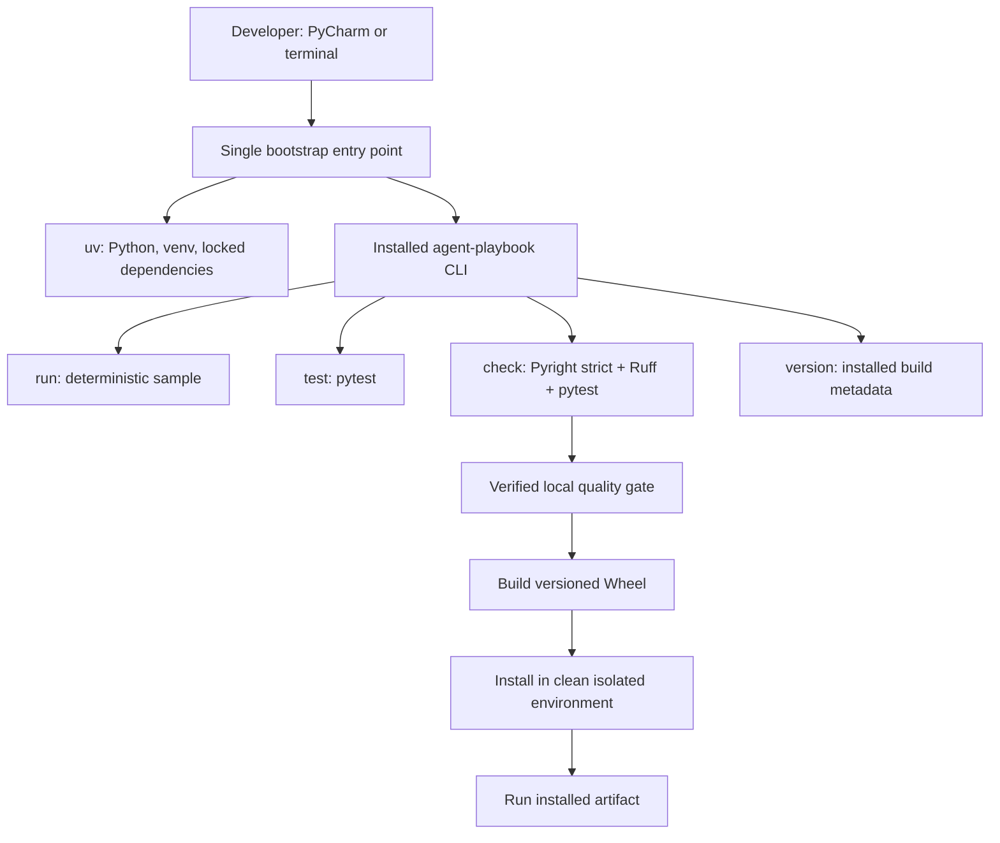

# Stage 00 — Development Foundation Architecture

Status: **PROPOSED / AWAITING EXPLICIT USER APPROVAL**. Do not implement or lock yet.

**Later decision, 2026-11-21.** Stage 00 used local checks and tied minor versions to stages. [Sharon’s approval](https://github.com/SharonLanger/agent-playbook/pull/63#issuecomment-7062463938) of the [PR CI design](../../refactors/pr-ci/README.md) adds hosted PR checks once public. Maintainer versions now advance independently of stages. Patch covers compatible fixes, minor covers features and may include documented breaking changes in 0.x, and moving to 1.0 is an explicit stability decision. The original Stage 00 decisions below remain the record of that stage.

## Goal
A reproducible, strongly type-checked Python application that runs from PyCharm or a terminal, can be tested deterministically, and can be built and executed as a versioned isolated Wheel release. No CrewAI dependency, agent workflow or Langfuse integration in this stage. Each substage introduces only one principal new concept; the single bootstrap command evolves incrementally.

## End-state architecture



## Boundaries
- **Single setup entry point**: one documented command prepares Python, the virtual environment, dependencies, CLI and developer checks. Idempotent, fail-fast, and re-runnable. No scattered manual setup sequence. It may call subordinate internal tools, but users invoke one entry point.
- **Application CLI**: `agent-playbook run|test|check|version`. `run` and `version` work in installed release mode; `test` and `check` are development-only commands and fail clearly if developer tools/source are absent. Packaging/build is a development operation, not a production CLI dependency.
- **Toolchain**: uv, Pyright strict, Ruff, pytest. CrewAI is deferred to Stage 01. Exact Python/tool versions are pinned in implementation design after compatibility verification.
- **Releases**: build a Wheel after passing checks; record version, Git commit, and artifact SHA-256 externally; embed version/source build metadata. Verify installed artifact from a clean environment without editable imports.
- **IDE**: PyCharm is the primary IDE. Run configurations may be provided for main and checks; IDE-generated `.idea/` is ignored.
- **Git hygiene**: ignore `.venv/`, `.idea/`, caches, local secrets and build outputs; commit project configuration, lockfile and example settings.
- **No CI**: run checks locally. Do not create GitHub Actions workflows.
- **Incremental progression**: start with a runnable Python entry point, then add the CLI, typing, testing, lint/format, unified checks, and artifact release one at a time. The final single bootstrap command prepares everything accumulated so far; do not create separate user-facing setup procedures.\n- **No premature abstractions**: application source stays minimal. No real agents, workflow orchestration, provider adapters or Langfuse until their learning stages.

## Version convention
Project-specific `MAJOR.MINOR.PATCH`: major stays `0` during learning; minor represents the stage; patch represents a verified substage/release iteration. First verified release: `0.0.1`. New stage first release: `0.1.0`. Stable reusable platform: `1.0.0` when separately approved. A version label is not a content identity; use SHA-256 to verify the exact Wheel bytes.

## Proposed layout (not yet created)
```text
app/
  README.md
  pyproject.toml
  uv.lock
  .python-version
  .gitignore
  .env.example           # only if configuration is needed
  src/agent_playbook/
    __init__.py
    __main__.py
    cli.py
    sanity.py
  tests/test_sanity.py
  scripts/bootstrap.py   # single setup entry point
  scripts/check.py       # invoked through CLI; internal helper
```

## Stage gate
Explicit approval of this document and `plan.md` locks the stage baseline. Proposed changes thereafter require an exact line-level diff and prior user approval. Implementation starts only after that approval.
