# Stage 01 — CrewAI Flows: review package

**Design approved; all three workflows are implemented for review.**
The design PR merged before implementation. Start with the code-reading guide, then learn
the independent workflows one at a time. Verification results and remaining Mac acceptance
are recorded in findings.

## Start here

**[Verify first, then read the code](learning/00-reading-the-code.md)** provides setup,
PyCharm buttons, the common call path and a learning session plan.

1. Read [the diagram guide](diagrams/README.md); its animations appear directly in Markdown.
2. Read [the mental model](learning/01-flow-basics.md).
3. Read [the stage architecture](architecture.md) and [file ownership map](file-structure.md).
4. Work through [WF-01](workflows/wf-01-step-sequence.md), [WF-02](workflows/wf-02-shared-state.md), then [WF-03](workflows/wf-03-conditional-route.md).
5. Review [failure behavior](learning/05-failures-and-tests.md), [CLI and releases](learning/06-running-and-releasing.md), and [the test specification](test-plan.md).
6. Review [the implementation sequence](plan.md) and [refactor coordination](coordination.md).

The diagrams are illustrative simulations, not traces of an implemented application.
Moving connectors show direction; the lesson's numbered execution table states actual order.
Animated SVGs are embedded directly in the Markdown architecture, lessons and workflow guides.
The optional HTML gallery provides pause controls and expanded notes; it needs no server.
SVG animation depends on the Markdown viewer and its motion settings; static siblings remain
available for viewers that suppress motion.

## Three workflows, one new concept each

| ID | Python package | Principal new concept | Default result |
|---|---|---|---|
| WF-01 | `wf_01_step_sequence` | Start and listen; values passed between steps | `[Hello, workflow!]` |
| WF-02 | `wf_02_shared_state` | Typed state and fresh state for every run | `20`, history `[3, 5, 20]` |
| WF-03 | `wf_03_conditional_route` | Choose exactly one branch | score 80 → `pass` |

Each workflow owns its code and tests. The shared application runner selects and invokes one;
it does not contain workflow formulas, threshold rules or workflow-specific state.

## Document roles

| File | Role | Review status |
|---|---|---|
| `architecture.md` | Stage end state and behavioral boundaries | Approved baseline |
| `file-structure.md` | Exact intended placement and reuse labels | Approved baseline |
| `plan.md` | Implementation order and gates | Approved baseline |
| `workflows/*.md` | Workflow contracts, examples and expected behavior | Approved baseline |
| `learning/*.md` | Full lesson sequence, illustrative code and exercises | Read alongside implementation |
| `test-plan.md` | Required tests, scenarios and evidence | Acceptance specification; results in findings |
| `coordination.md` | Snapshot of PR #28 and integration checks | Integration snapshot |
| `findings.md` | Verified documentation checks and unresolved implementation probes | Evidence only |
| `sources.md` | Official references and diagram provenance | Reference material |

## Permanent project material

This package lives permanently in `designs/stages/01-crewai-flows/`. Keep its architecture,
plan, lessons, workflow contracts, examples, tests specification and diagrams for future
contributors and agents. Review status does not make a document temporary. Approval updates
its status in place; implementation does not trigger deletion or relocation.

`designs/temporary/` is only for disposable agent-to-agent handoffs. Before deleting a handoff,
ensure any lasting decisions or required knowledge are captured in permanent project documents.
Do not treat this stage package as a handoff or remove it during handoff cleanup.
The shared diagram policy lives at [AUTHORING.md](../../diagrams/AUTHORING.md).

## Optional independent experiments

[Self-contained workflow sandboxes](../../../app/examples/workflows/README.md) explore method triggers, router labels, deliberate collisions and the official routing patterns. Each has its own run.py and README. These experiments do not change the integrated workflow contracts.
