# Stage 01 — Completed-stage architecture

**Approved Stage 01 baseline — Sharon authorized implementation on 2026-11-12.**
This is the intended final architecture for this stage; later Langfuse and agent stages
retain their separate scope. The behavioral baseline is locked; verification is recorded in findings.

[Optional pause controls](diagrams/00-architecture.html)

## Outcome

A developer selects one of three deterministic CrewAI Flows, supplies optional JSON input,
sees step start/finish messages, and receives a result or a clear failure status. The same
behavior works from PyCharm, the editable CLI and a clean isolated release. No model key,
agent SDK, external business service or Langfuse server is required for a workflow run.
Dependency installation can require network access; runtime offline behavior must be tested.

## Responsibilities and interfaces

These are the approved contracts; implementation and verification are linked from the learning guide.

| Owner | Contract | Reuse |
|---|---|---|
| CLI | Parse workflow ID/raw JSON and release version; present result/error and exit status | All workflows |
| Application runner | `run_workflow(workflow_id, raw_input, *, config_path=None) -> RunResult`; select a workflow, validate its input, create a fresh flow, invoke it and normalize successful output | All workflows |
| Application result | Small immutable `RunResult(workflow_id: str, output: str)` for successful presentation | All workflows |
| Workflow flow | Decorated methods and dependency/routing graph; owns its run's state | One workflow |
| Workflow state/input | Strict user-input model and, where needed, internal state schema | One workflow |
| Workflow steps | Pure domain functions; no CLI, subprocess or provider dependency | One workflow unless later reuse is demonstrated |
| Release launcher | Select a completed installation and forward explicitly supplied workflow arguments unchanged as argv entries | All workflows |
| Tooling | Pin/setup dependencies, gate, build and verify releases | Development only |

Use a small explicit selection function (three branches is sufficient). No dynamic plugins,
workflow base-class hierarchy, container, global utility bucket or generic execution engine.
CrewAI already owns scheduling. A tiny RunResult gives the CLI a stable presentation boundary;
do not build a generic event/result schema before Stage 02 needs one.

## Run contract

1. CLI chooses source execution (`dev-run`) or installed execution (`run`).
2. The runner verifies workflow ID and external configuration, applies CrewAI startup settings before framework imports, parses a JSON object, then validates only that workflow's schema.
3. Create a new Flow instance for every invocation. Never reuse state across runs.
4. Invoke the flow synchronously; decorated methods delegate computations to local steps.
5. Emit a plain `[WF-02] add started` / `finished` message around each real step.
6. Return a successful RunResult; the CLI prints it and exits 0.

Logging is deliberately simple in Stage 01. Do not create the future Langfuse abstraction yet.
Tests assert ordering of application messages, not exact framework banners, timings or UUIDs.
Steps do not sleep by default. Slow-motion teaching belongs in the diagram controls.

## Inputs and results

| Workflow | Allowed input | Defaults | Output |
|---|---|---|---|
| wf-01 | absent or `{}` only | fixed message | `[Hello, workflow!]` |
| wf-02 | `initial`, `increment`, `multiplier`: strict integers, each -1000..1000 | 3, 2, 4 | string representation of final value; native state history available to workflow tests |
| wf-03 | `score`: strict integer, 0..100 | 80 | `pass` if score >= 60, else `needs_work` |

Reject unknown fields, JSON arrays/scalars, booleans as integers and numeric strings.
WF-02 demonstrates typed internal state separately from validated user input. Do not expose
internal `history`, `value`, `decision` or CrewAI IDs as settable CLI fields.
The score threshold is a workflow rule, not a global config setting.

## Failure semantics

| Situation | Behavior | CLI exit |
|---|---|---|
| Invalid configuration, option, ID, JSON or input model | Reject before workflow steps start; report the offending input | 2 |
| A Python step raises | Report workflow/step failure; downstream steps do not run; no success message | 1 |
| Valid WF-03 `needs_work` result | Successful business decision; only that branch executes | 0 |
| Missing compatible built release | Preserve actionable release-selection error | 2 |

A step exception must remain an exception across the flow boundary. Translate it to the CLI
failure boundary without turning it into a successful string. Preserve the exception cause
for tests/debugging. Do not catch KeyboardInterrupt/SystemExit or claim automatic recovery.
A concrete exception-propagation probe against the chosen CrewAI version is an 01.1 gate.
Use test-injected failures, not a permanent public `--fail` flag.

## State and routing

WF-01 teaches return-value passing; it needs no custom state.py. WF-02 adds its own typed
state, with per-instance list defaults and explicit validation behavior. WF-03 uses its own
score/decision state and two named router outcomes. Each branch terminates independently;
there is no artificial join waiting for a branch that did not run. Do not execute the router
or listeners as ordinary function calls to simulate a framework integration test.

No parallel branches, retries, loops, persistence, resume, approval UI or real agents in this
stage. These simple examples are intentionally not a production workflow engine.

## External configuration (approved follow-up)

Sharon approved an external YAML file independent of application releases, with
separate integration/workflow ownership. `app/configs/application.yaml` provides
shared CrewAI settings; a sibling `.local.yaml` and documented environment overrides
may replace values. `--config` selects a file ahead of `AGENT_PLAYBOOK_CONFIG`.
The source launcher passes the external path to the installed release; no active
configuration is bundled in the wheel. Installed direct invocations require a path
selector. Reload on each invocation; validate unknown/missing/invalid fields before work.

The runner passes typed CrewAI settings to initialization and each flow. Workflow
package imports have no configuration side effects. Import-time telemetry/tracing
changes after framework initialization require a new process. WF-03 keeps its named
`PASS_THRESHOLD` constant; no workflow rule becomes a CrewAI setting. The loader is
an in-process component, not a configuration server. See
[operating rules](../../../app/configs/README.md).

## Dependencies, telemetry and release boundary

The Python target is 3.13. The implementation pins CrewAI 1.15.40 and explicitly declares
Pydantic 2.12.5 and PyYAML 6.0.3 because they are imported directly.
Record resolved versions and import/typing behavior. Do not copy an unverified latest version
into the baseline or weaken global Pyright strictness to hide third-party typing problems.

Configure telemetry/tracing before importing the framework. For the currently reviewed docs,
CrewAI telemetry and AMP tracing have separate disable controls. Verify the selected version's
`CREWAI_DISABLE_TELEMETRY=true` and `CREWAI_TRACING_ENABLED=false` behavior and prohibit model
calls. Avoid globally disabling all OpenTelemetry as an architectural policy: Stage 02 needs it.
Shared defaults disable both; users may enable them explicitly through configuration.
Tests and release verification use dedicated offline settings, independent of user
overrides. Tests plus an isolated no-credentials/offline run must support any
offline-runtime claim, which applies only with telemetry/tracing disabled.

**Release dependency contract:** export the production dependency closure from the archived
commit's lockfile, excluding the project and dev group, with hashes. Install those locked
requirements into the fresh release venv, then install the separately hash-verified application
wheel without resolving new dependencies. Preserve the lock/export and its hash as release
evidence. Do not import the archive or editable tree at runtime. Verify dependency consistency,
installed imports and all workflows before marking complete. This change is part of 01.1,
not an incidental edit to PR #28. Probe exact uv 0.13.6 flags and platform markers before
implementation acceptance; do not promise a cross-platform bundle or air-gapped installation.

The application wheel alone does not contain CrewAI's dependency tree. Installation size
will grow; record measured wheel and environment sizes when the pin is tested.

## Acceptance

All three workflows work independently with deterministic results. Input/failure behavior,
fresh state, exact route choice and skipped steps are covered by tests. All current developer
commands and release isolation guarantees remain intact. Source and installed commands agree.
Static checks pass; the Mac PyCharm path is confirmed by Sharon. Release completion includes
the new runtime dependencies, not only unit tests with mocked imports. See test-plan.md.

