# Visual guide

The animations are embedded below and directly in the architecture, lessons and workflow
contracts. You can read the explanations and see the moving diagram together in Markdown.
Motion is illustrative, not a runtime trace. Reduced-motion preferences hide moving dots
and stop the dashed-line animation.

SVG animation depends on the Markdown viewer. Static SVG siblings are available as a fallback.
The optional local [HTML gallery](index.html) adds pause/resume controls and expandable step
notes. No server or dependencies are needed to view it; HTML is not the only animated version.

## Shared architecture

[Static SVG](00-architecture.svg) · [Optional pause controls](00-architecture.html)

## WF-01 — Step Sequence

[Static SVG](01-sequence.svg) · [Optional pause controls](01-sequence.html)

## WF-02 — Shared State

[Static SVG](02-state.svg) · [Optional pause controls](02-state.html)

## WF-03 — Pass route, score 80

[Static SVG](03-route-pass.svg) · [Optional pause controls](03-route-pass.html)

## WF-03 — Needs work route, score 40

[Static SVG](04-route-needs-work.svg) · [Optional pause controls](04-route-needs-work.html)

## Authoring provenance

These diagrams use Dashmotion's pinned renderer, templates and structural checker, with
project-specific semantic graphs and explanatory notes. See [sources](../sources.md) and
[MIT notices](THIRD-PARTY-NOTICES.txt). The companion Animated SVG video pipeline was not run.
The animated siblings retain the same connector paths, CSS and SMIL motion without scripts.
Reduced-motion behavior is implemented in SVG CSS because images cannot use the HTML scripts.
The static siblings remove moving-dot elements and animations while preserving the graph.

For changes, read [the permanent authoring policy](../../../diagrams/AUTHORING.md). Recreate
semantic graph inputs from these workflow contracts in a temporary authoring directory,
then run the pinned Dashmotion `scripts/layout.py <graph.json> --render <output.html>`.
Follow its flow/architecture reference for graph schema. Add local lesson/navigation text,
regenerate animated and static SVG siblings, and rerun `scripts/check_diagram.py` on every final animated file.
Keep the input graphs outside delivered outputs as directed by that authoring workflow.
