# Stage 01 — Verify first, then read the code

This is the starting point for learning the three implemented examples. All are available
in one implementation PR at Sharon's request; learn them in order. There are no model keys,
prompts, real agents or Langfuse services to configure. Each workflow is independent and
shares only application selection, presentation and release infrastructure.



## 1. Prepare and verify

In PyCharm, open the repository root, run **Setup**, and select `app/.venv/bin/python` as
the project interpreter. Setup refreshes the locked dependencies, runs default WF-01 and
runs **Check**. Then use the following buttons; all use the same project interpreter.

| Button | What you should see |
|---|---|
| Check | Types, lint, formatting and pytest all PASS |
| WF-01 Sequence | produce → decorate → finish; `[WF-01] result: [Hello, workflow!]` |
| WF-02 State | initialize → add → multiply → finish; `[WF-02] result: 20` |
| WF-03 Route | begin → choose → accept; `[WF-03] result: pass` |
| Test WF-01 / Test WF-02 / Test WF-03 | Only that workflow's tests |
| Tests | Entire test suite, including shared CLI/release/tooling behavior |

If a workflow fails, keep its output and run its own Test button first. If Check stops early,
read which check failed: later NOT RUN entries are not failures of those later tools. Use
**Format** only for formatting errors; it cannot fix incorrect types or behavior.

The equivalent commands, from the repository root, are:

```sh
python3 app/tooling/bootstrap.py
app/.venv/bin/agent-playbook check
app/.venv/bin/agent-playbook dev-run --workflow wf-01
app/.venv/bin/agent-playbook dev-run --workflow wf-02
app/.venv/bin/agent-playbook dev-run --workflow wf-03 --input '{"score":40}'
```

For targeted pytest in a terminal, first change directory to `app`, then run
`.venv/bin/python -m pytest -q tests/workflows/wf_01_step_sequence` (change the folder for
WF-02/WF-03). The shared Test WF buttons already have this working directory configured.

## 2. Read the common path once

All source links below refer to real files. Start with their named function, not every import
or framework internals. The diagram describes ownership; the table describes an actual call.

| Read in this order | What to find | Reused? |
|---|---|---|
| [cli/commands.py](../../../../app/src/agent_playbook/cli/commands.py) | `build_parser`, `main`, `present_workflow`: parse, select source/release, print and return status | Yes |
| [application/runner.py](../../../../app/src/agent_playbook/application/runner.py) | `run_workflow`: validate JSON and selected input, construct a fresh flow, call kickoff | Yes |
| [application/results.py](../../../../app/src/agent_playbook/application/results.py) | Immutable RunResult; different input/execution error classes | Yes |
| [workflows/__init__.py](../../../../app/src/agent_playbook/workflows/__init__.py) | Disable CrewAI usage telemetry and AMP tracing before importing flow modules | Stage-wide local policy |
| Selected workflow's `flow.py` | Decorators describe step dependencies; messages show real execution | Specific to that workflow |
| Selected workflow's `steps.py` | Ordinary Python computations independent of scheduling | Specific to that workflow |

The runner has three explicit cases rather than a plugin framework. Adding a fourth workflow
later adds another named package, its own tests and a selection case. It does not edit the
first three workflows' formulas. A fresh flow is created each time: mutable history is never
stored in a shared runner singleton. Do not subclass another example merely to reuse a graph;
CrewAI's DSL inheritance has separate behavior that these examples do not promise to support.

`Flow` is the framework class; our workflow classes are concrete examples. `kickoff()` starts
the graph synchronously. `@start`, `@listen` and `@router` tell CrewAI when a method is eligible.
They do not replace normal Python parameters, return values or exceptions.

## 3. Learn one workflow at a time

1. [WF-01 — Step Sequence](../workflows/wf-01-step-sequence.md): read two pure functions,
   then the three decorated methods. Predict the returned string before running.
2. [WF-02 — Shared State](../workflows/wf-02-shared-state.md): distinguish caller input from
   computed state; inspect `value` and `history` at each breakpoint.
3. [WF-03 — Conditional Route](../workflows/wf-03-conditional-route.md): try score 80, 40,
   60 and 59. Prove the unchosen terminal method never runs.

Each guide contains its file map, execution trace, exact test locations, debugging exercise,
expected answers and responsibility boundaries. The earlier six concept lessons remain
useful; these guides connect those explanations to the implemented code.

## 4. Understand tests before changing behavior

Pure-function tests answer “is the calculation correct?” Schema tests answer “which input is
allowed?” Flow tests call real kickoff and answer “did the intended steps run?” Application,
CLI and release tests answer “can a caller actually select, execute and deliver this flow?”

Tests do not replace kickoff with a mock in workflow integration cases. Failure tests inject
an exception at a domain operation or state assignment and assert that downstream work does
not report success. A failed Python step exits 1; invalid input exits 2. A valid `needs_work`
route exits 0: an assessment result is not a broken process.

The fresh-process [offline probe](../../../../app/tooling/verify_runtime.py) installs a Python
audit hook before imports. It denies and records socket/DNS attempts, runs all routes and
invalid input, and fails even if third-party code swallowed a denied attempt. This checks
these Python execution paths; it is not a general OS network sandbox. See the recorded
[verification evidence](../findings.md) for what actually ran.

## 5. Source versus release

Use **Dev Run** or the named workflow buttons while learning code. **Run** executes the latest
verified local release; it cannot see source edits until another release is built. After
reviewing and committing edits, **Release** runs the gate, builds the wheel, installs its
locked runtime dependencies in a fresh environment and verifies the workflows offline.

A wheel is an installable archive of this application's package and metadata. It is not a
copy of the repository and does not contain CrewAI's entire dependency tree. The release
folder also contains that dependency environment, `requirements.txt`, `uv.lock`, hashes and
verification metadata. CrewAI brings many dependencies, so environment size is much larger
than the application wheel. Read the measured sizes in findings before accumulating releases.

CLI options and build rules live in [app/docs/cli.md](../../../../app/docs/cli.md). This learning
guide explains how to read the implementation; that document is the command reference.

## Suggested learning session

For each workflow: predict the result → run its button → read steps.py → read flow.py → inspect
state at breakpoints → run its Test button → make one deliberate local change → observe the
relevant failure → restore it → run Check. Keep each session focused on one new concept.
No additional setup decisions are needed from Sharon before reviewing this implementation.
The remaining local acceptance is running Setup, Check and the three workflow buttons in
macOS PyCharm and confirming the embedded animations display as expected.
