# Lesson 1 — A flow is an execution graph

Read this before WF-01. The implementation is linked from each workflow guide.

A normal function call says “do this now.” A Flow declaration says “this step is eligible
when that step completes.” CrewAI coordinates the graph. The application starts it with
`kickoff()`; the CLI should not manually call every step in order.

| Term | Meaning in this stage | Familiar comparison |
|---|---|---|
| Flow | One declared graph, with a fresh instance for each run | A small workflow object |
| Step | A method that does one part of the work | An ordinary method plus scheduling metadata |
| `@start()` | The initial eligible step | Entry node, not a polling loop |
| `@listen(previous)` | Run after the named predecessor completes | Dependency on a previous task |
| Return value | Data delivered along a step dependency | Function result |
| State | Data owned by one flow execution | Typed per-request context |
| Router label | A named choice controlling which listener runs | Explicit branch selection |

## Read the graph before the code



A pulse means direction of transfer;
it is a teaching animation, not a measured runtime speed or proof that steps run concurrently.

Minimal teaching excerpt (the implementation uses verified CrewAI 1.15.40):

```python
from crewai.flow.flow import Flow, listen, start

class StepSequenceFlow(Flow):
    @start()
    def produce(self) -> str:
        return "Hello, workflow!"

    @listen(produce)
    def decorate(self, message: str) -> str:
        return f"[{message}]"
```

Read top to bottom: produce returns a string; decorate receives it. Defining the class does
not execute the graph. Creating an instance and calling `kickoff()` requests a run. Our
implementation moves the string operations into steps.py; this compact example keeps them
inline only to explain decorators first. Adding a final listener teaches returning the final
result to the application without putting CLI output code inside the domain functions.

## Why not just call two Python functions?

For this tiny example, ordinary calls would suffice. We deliberately use a small graph to
learn the orchestration boundary before introducing state and routing. This stage does not
claim a framework makes every short script better. Observe what scheduling provides and what
remains our responsibility: validation, business rules, errors, tests and presentation.

## Exercise and expected answer

1. Predict which method starts if you move decorate above produce in the source.
   In this decorator form it references produce during class construction, so the name must
   already exist. Source definitions and runtime scheduling are different issues.
2. Add a third listener on decorate. Expected order: produce, decorate, finish.
3. Change the returned string. The next listener must receive the new value.
4. Make decorate raise in a test. Finish must not run; no successful result is reported.

Do not introduce a crew, model, task prompt or API key. The step is ordinary Python logic.
Next: [WF-01 contract](../workflows/wf-01-step-sequence.md).
