# Lesson 2 — WF-01: follow the returned value

Scope: `workflows/wf_01_step_sequence/`; tests in the same named folder under `tests/workflows/`.
Read [the contract](../workflows/wf-01-step-sequence.md) beside the animation.



| Order | Flow method | Pure function | Receives | Returns |
|---|---|---|---|---|
| 1 | produce | `make_message()` | nothing | `Hello, workflow!` |
| 2 | decorate | `decorate_message(message)` | prior string | `[Hello, workflow!]` |
| 3 | finish | no extra helper needed | decorated string | same string to the caller |

`flow.py` teaches orchestration. `steps.py` teaches the computation. A string-only exercise
needs no custom state model or state.py. CrewAI may have internal flow state; we simply do
not add application state yet.

Illustrative pure functions:

```python
def make_message() -> str:
    return "Hello, workflow!"

def decorate_message(message: str) -> str:
    return f"[{message}]"
```

Illustrative test specifications (not executable test files in this PR):

```python
def test_decoration_preserves_the_message():
    assert decorate_message("Hello, workflow!") == "[Hello, workflow!]"
    assert decorate_message("") == "[]"
```

The flow integration test must invoke a fresh StepSequenceFlow through kickoff and verify
its final return. Observe step order by capturing our start/finish messages or recording a
spy around pure steps. Do not mock kickoff: that would skip the orchestration we want to learn.

Expected application messages, excluding framework-specific banners:

```text
[WF-01] produce started
[WF-01] produce finished
[WF-01] decorate started
[WF-01] decorate finished
[WF-01] finish started
[WF-01] finish finished
[WF-01] result: [Hello, workflow!]
```

Exercise: change brackets to braces, predict the failing assertion, run the workflow test,
then restore the agreed output. This distinguishes a behavior regression from a type error:
both strings are correctly typed, but only one matches the contract.
