# Lesson 3 — WF-02: state belongs to one run

Scope: `workflows/wf_02_shared_state/`. New concept: a typed state object persists between
steps of one execution. It is not a database and is not shared between workflow invocations.



## External input versus internal state

Input describes what the caller may choose. State also contains computed fields owned by the
workflow. Keep them separate so a caller cannot inject fabricated history or a final result.

Illustrative schema excerpt:

```python
from pydantic import BaseModel, ConfigDict, Field

class NumberInput(BaseModel):
    model_config = ConfigDict(strict=True, extra="forbid")
    initial: int = Field(default=3, ge=-1000, le=1000)
    increment: int = Field(default=2, ge=-1000, le=1000)
    multiplier: int = Field(default=4, ge=-1000, le=1000)

class NumberState(BaseModel):
    model_config = ConfigDict(validate_assignment=True)
    initial: int = 3
    increment: int = 2
    multiplier: int = 4
    value: int = 0
    history: list[int] = Field(default_factory=list)
```

This excerpt explains ownership, not the finalized constructor/kickoff wiring. Validate
NumberInput first, then initialize a new NumberState using only validated fields. Do not
apply `extra="forbid"` blindly to framework-internal state if the selected version injects
its own ID; probe that integration in 01.1. Assignment validation and strict input validation
are different settings. Pyright checks source statically; Pydantic checks actual input values.

## Predict the state

| After step | value | history |
|---|---:|---|
| initialize | 3 | `[3]` |
| add increment | 5 | `[3, 5]` |
| multiply | 20 | `[3, 5, 20]` |
| finish | 20 | unchanged |

The actual formula is `(initial + increment) * multiplier`. Return values can signal that a
step finished while the next step reads `self.state`. Do not duplicate independent versions
of value in both a mutable global and the flow state.

## Exercises with answers

- Input `{ "initial": 10, "increment": -2, "multiplier": 3 }`: predict 24 and `[10, 8, 24]`.
- Multiplier 0: final 0; history must still include the preceding intermediate values.
- Input `{ "initial": "3" }`: reject numeric string, exit 2, no steps started.
- Input `{ "history": [999] }`: reject unknown external field, exit 2.
- Run twice: each run has its own history; neither becomes `[3,5,20,3,5,20]`.

Use `default_factory=list` to make per-instance ownership explicit. Test independent objects,
not Python list identity alone: run both flows and assert their real histories and outcomes.

Tests live in `tests/workflows/wf_02_shared_state/test_state.py` and `test_flow.py`.
Next: [WF-02 complete contract](../workflows/wf-02-shared-state.md).
