# Lesson 4 — WF-03: select exactly one route

Scope: `workflows/wf_03_conditional_route/`. New concept: the next step depends on validated
state. Compare the two routes below.

**Score 80: pass**



**Score 40: needs work**



The rule is fixed for this workflow: score >= 60 passes. A score below 60 is a valid result;
it does not mean Python or CrewAI failed. The CLI exits 0 for either business outcome.

Illustrative orchestration excerpt (assumes the workflow's ScoreState is defined):

```python
class ConditionalRouteFlow(Flow[ScoreState]):
    @start()
    def begin(self) -> int:
        return self.state.score

    @router(begin)
    def choose(self, score: int) -> str:
        return "pass" if score >= 60 else "needs_work"

    @listen("pass")
    def accept(self) -> str:
        self.state.decision = "pass"
        return "pass"

    @listen("needs_work")
    def revise(self) -> str:
        self.state.decision = "needs_work"
        return "needs_work"
```

Imports and pure-function delegation are omitted here to isolate the new routing concept;
see source references for the decorator APIs. During implementation, give the router return
a narrow Literal type where the chosen framework's typing supports it.

A label is an event name; it is not a method call. Returning `pass` activates the matching
listener. Do not call both terminal methods yourself. There is no join: waiting for both
branches would misunderstand an exclusive decision as parallel work.

| Input score | Route | Terminal step | Other terminal step | Exit |
|---|---|---|---|---:|
| 80 | pass | accept | skipped | 0 |
| 60 | pass | accept | skipped | 0 |
| 59 | needs_work | revise | skipped | 0 |
| 0 | needs_work | revise | skipped | 0 |
| 101 | invalid input | none | none | 2 |

Exercise: change `>=` to `>` temporarily. Only the exact boundary score 60 changes outcome;
the boundary test should expose the regression. Restore the rule. Then inject an exception
into the chosen terminal step and observe exit 1, not a normal `needs_work` result.

Tests must assert that the unselected step did not run. Checking only the final output could
miss an implementation that incorrectly executes both paths and returns the last value.
