# WF-02 — Shared State

**Workflow-specific implementation and learning guide.**

New capability: Typed mutable state scoped to one execution.


[Optional pause controls](../diagrams/02-state.html) · [Lesson](../learning/03-typed-state.md)

## Ownership

Implementation: `app/src/agent_playbook/workflows/wf_02_shared_state/`.
Tests: `app/tests/workflows/wf_02_shared_state/`.
This flow, its steps and any state models belong only to this workflow. Reuse the application
runner and CLI entry points; do not put this workflow's domain rules in either shared owner.
See [the file map](../file-structure.md) for file ownership.

## Input

initial=3, increment=2, multiplier=4; strict integers -1000..1000. Unknown fields and non-object JSON are rejected before execution.
Create a fresh Flow instance for each invocation. No randomness, sleeps, filesystem writes,
network operations or model invocations are part of the business steps.

## Execution

1. initialize: value = initial; history = [initial].
2. add: value += increment; append value.
3. multiply: value *= multiplier; append value.
4. finish: return final value, leaving history available to tests.

Expected default outcome: **20; history [3, 5, 20]**.
Start/finish messages identify WF-02 and the step name; they explain execution rather
than replacing state/result assertions. A failing step reports failure and prevents downstream
success. Test failures through dependency replacement scoped to the test, not public flags.

## Tests and review

Required test IDs: S02, V02, F03, F04, F05. Definitions are in [test-plan.md](../test-plan.md).
Check computation, real framework execution and failure behavior separately. Confirm the
expected result manually, then deliberately break one relevant rule, observe the failing
test, and restore it. The full quality gate remains required before release.

## Read the implemented code

| File | Read | Ownership |
|---|---|---|
| [state.py](../../../../app/src/agent_playbook/workflows/wf_02_shared_state/state.py) | NumberInput versus NumberState | WF-02 external/internal schemas |
| [steps.py](../../../../app/src/agent_playbook/workflows/wf_02_shared_state/steps.py) | add and multiply | WF-02 arithmetic |
| [flow.py](../../../../app/src/agent_playbook/workflows/wf_02_shared_state/flow.py) | initialize, add, multiply, finish | WF-02 orchestration/state changes |
| [test_state.py](../../../../app/tests/workflows/wf_02_shared_state/test_state.py) | Strict input and independent lists | WF-02 validation tests |
| [test_flow.py](../../../../app/tests/workflows/wf_02_shared_state/test_flow.py) | Real histories, repeated runs, failure skip | WF-02 framework tests |
| [test_steps.py](../../../../app/tests/workflows/wf_02_shared_state/test_steps.py) | Negative, zero and default operands | WF-02 calculation tests |

NumberInput is the public request. NumberState includes computed value/history; the caller
cannot supply those fields. `ConfigDict(strict=True, extra="forbid")` rejects numeric strings,
booleans, unknown fields and values outside -1000..1000. After validation the runner copies
only the three permitted values into a new state and passes it as `initial_state` to a fresh
SharedStateFlow. CrewAI adds its own flow ID; it is not a public input field.

`Field(default_factory=list[int])` makes a new typed list per model instance. The explicit
`[int]` also satisfies the project's strict Pyright check. `validate_assignment=True` checks
field assignments; in-place list mutations still need correctly typed code and tests.

## Run and inspect state

Use **WF-02 State**. Default input gives `(3 + 2) * 4 = 20`. For another run:

```sh
app/.venv/bin/agent-playbook dev-run --workflow wf-02 --input '{"initial":10,"increment":-2,"multiplier":3}'
```

| After method | Default value/history | Custom value/history |
|---|---|---|
| initialize | 3 / [3] | 10 / [10] |
| add | 5 / [3, 5] | 8 / [10, 8] |
| multiply | 20 / [3, 5, 20] | 24 / [10, 8, 24] |
| finish | returns 20; history unchanged | returns 24; history unchanged |

Unlike WF-01, intermediate methods return None: their completion triggers the listener,
while shared state carries the data. Each method reads `self.state`, updates its value, then
appends the computed value to history. Finish returns only the final number; the runner
normalizes it to the string in RunResult. The CLI prints the result, not the entire history.

In PyCharm, put a breakpoint after each `history.append` and inspect `self.state.value` and
`self.state.history`. Run the task again and see fresh state. To alter input through the IDE,
copy the task and append `--input '{"initial":10,"increment":-2,"multiplier":3}'` to its module
parameters; keep the project interpreter and working directory unchanged.

## Verify and experiment

Use **Test WF-02**. Schema tests reject `true`, `"3"`, 1001, unknown `history`/`value`/`id` fields
and other invalid inputs. Flow tests use real kickoff for defaults, custom numbers and zero
multiplier. Independent runs retain their own complete histories. A failed add leaves history
at [3] and prevents multiply from starting.

Exercise: temporarily remove the history append in multiply. The numeric CLI result can still
be 20, but the state-history assertion fails. This demonstrates why checking only final output
misses state regressions. Restore it and rerun the workflow tests and Check.

Try `--input '{"initial":"3"}'`: expect exit 2 and no step started. A genuine arithmetic-step
exception instead becomes exit 1 and keeps its original exception as the runner error's cause.
The formula, bounds and history schema belong to WF-02. They do not become global models or
utility functions merely because future workflows may also use integers.
