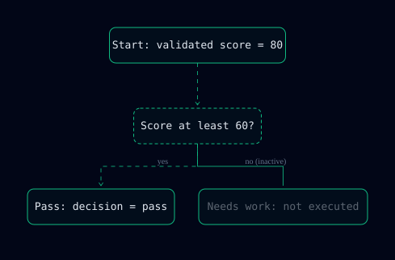

# WF-03 — Conditional Route

**Workflow-specific design. Proposed, not implemented.**

New capability: Exclusive routing from validated state.

[Animated version](../diagrams/03-route-pass.html) · [Lesson](../learning/04-routing.md)

## Ownership

Implementation: `app/src/agent_playbook/workflows/wf_03_conditional_route/`.
Tests: `app/tests/workflows/wf_03_conditional_route/`.
This flow, its steps and any state models belong only to this workflow. Reuse the application
runner and CLI entry points; do not put this workflow's domain rules in either shared owner.
See [the file map](../file-structure.md) for every proposed file.

## Input

score=80; strict integer 0..100. Unknown fields and non-object JSON are rejected before execution.
Create a fresh Flow instance for each invocation. No randomness, sleeps, filesystem writes,
network operations or model invocations are part of the business steps.

## Execution

1. begin: return the validated score.
2. choose: route pass for score >= 60, otherwise needs_work.
3. accept OR revise: set decision and return it; only one runs.

Expected default outcome: **pass for 80; needs_work for 40; both exit 0**.
Start/finish messages identify WF-03 and the step name; they explain execution rather
than replacing state/result assertions. A failing step reports failure and prevents downstream
success. Test failures through dependency replacement scoped to the test, not public flags.

## Tests and review

Required test IDs: S03, V03, F06, F07, F08. Definitions are in [test-plan.md](../test-plan.md).
Check computation, real framework execution and failure behavior separately. Confirm the
expected result manually, then deliberately break one relevant rule, observe the failing
test, and restore it. The full quality gate remains required before release.
